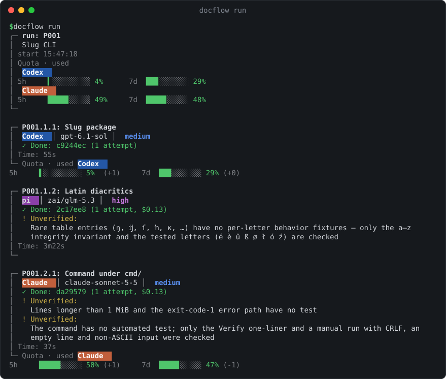
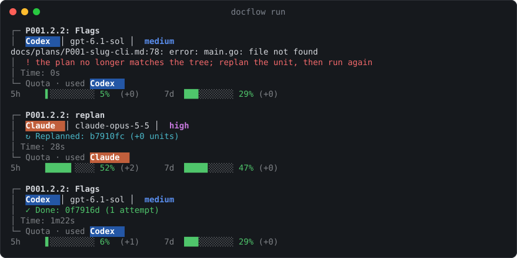
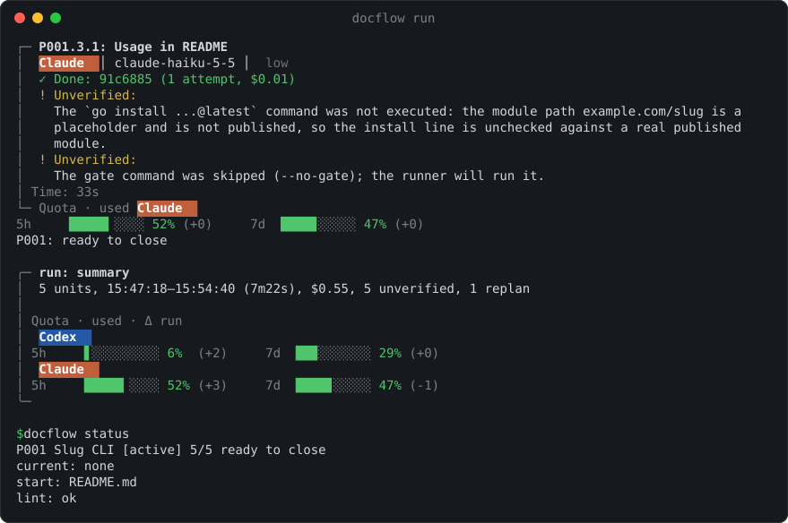

# bsv-docflow

[English](README.md) | Русский

bsv-docflow ведёт работу над ПО с AI-агентами как небольшой spec-driven
процесс: задача описывается планом, план делится на юниты размером в одну
сессию, каждый юнит выполняется, проверяется и коммитится сам, а закрытый
план сворачивается в архивную запись, где остаются решения. CLI — один
самодостаточный Go-бинарник, ставится одной командой; Go нужен только для
разработки.

## Зачем

Длинная сессия агента деградирует: контекст переполняется, агент теряет
нить, и ничто не доказывает, что результат проверялся. bsv-docflow держит
рабочее состояние в репозитории, а не в памяти агента.

- **Сначала спека.** Задача становится планом из фаз и юнитов на одну
  сессию. Юнит несёт Goal, список Read, Do, Verify, Traps и готовый
  subject коммита; `lint` проверяет его по бюджету чтения (цель — ~100k
  токенов на сессию), поэтому сессия открывается со своим ограниченным
  контекстом, а не со всем репозиторием.
- **Цикл принуждён, а не обещан.** `prompt → работа → finish`
  (verify → done → commit); команда отказывает, если предыдущий шаг не
  выполнен. `verify` снимает отпечаток рабочего дерева, и `commit`
  коммитит ровно это дерево — что проверено, то и закоммичено; один
  юнит — один коммит.
- **Весь план можно прогонять без человека.** `docflow run` ведёт юниты
  сам: даёт агенту промпт, проверяет, коммитит, повторяет упавший юнит,
  при лимите или недоступности провайдера переходит на запасного
  исполнителя, безопасно останавливается по таймауту или зависанию агента.
  Claude Code, Codex CLI, Pi, OpenCode и dsh (DeepSeek Harness) встроены;
  план назначает каждому юниту своего ассистента, модель и усилие.
  Ростер — одна таблица «доступ × роль плана»: `docflow roster scan` сам
  собирает модели, контекст, цену и ризонинг из Pi и OpenCode плюс
  известные метаданные Codex/Claude, `roster web` правит таблицу и
  именованные политики поверх неё («zai первым», «локальные выключены»)
  в браузере, `roster brief` печатает цепочку каждой роли с бюджетом
  чтения и объяснением, а `roster apply` пишет шапку плана
  ([подробности](docs/usage.md#автозапуск)).
- **Или делать всё в терминале.** `docflow tui` — рабочее место из
  четырёх экранов: «Проект» держит очередь, планы, Backlog и параметры
  проекта, «Ростер» правит доступы, условия и варианты и пишет шапку
  плана, «Прогон» показывает поток сообщений и рассуждений агента с
  паузой, остановкой и восстановлением, «История» повторяет прошлый
  прогон ([подробности](docs/usage.md#терминальное-приложение)).
- **Сессии передают работу.** Завершённый юнит оставляет Handoff и
  Decisions, промпт следующего уже несёт handoff его зависимостей и
  решения плана. Работа идёт сквозь сессии без перечитывания истории.
- **Решения остаются, балласт — нет.** Закрытие плана пишет архивную
  запись — итог, решения, грабли, follow-ups, — а рабочий план
  удаляется. Доки держат решения и ссылаются на архив вместо пересказа.

## Как это устроено

План — Markdown-файл из фиксированных блоков. Агент пишет их содержимое,
а CLI `docflow` владеет их состоянием и проводит через цикл.

```
docs/docflow.md             Queue · Backlog
docs/plans/P007-cache.md    Goal · Context · Traps · Decisions
  ## Phase 1
  ### [x] P007.1.1          Read · Do · Verify · Commit · Handoff
  ### [~] P007.1.2          ← в работе
  ### [ ] P007.2.1          Depends: P007.1.2
        │  close: все юниты [x]
        ▼
docs/archive/P007-cache.md  Outcome · Decisions · Gotchas · Follow-ups
```

`prompt` собирает промпт юнита из его блока, Decisions плана и Handoff
зависимостей и ставит `[~]`. `verify` запускает команду `Verify:` юнита
и снимает отпечаток дерева; `done` ставит `[x]` и пишет Handoff; `commit`
коммитит ровно это дерево с subject из `Commit:`. Юнит, который не может
идти дальше, `block` помечает `[!]`: устаревший план уходит на
перепланирование, шаг человека ждёт `docflow unblock <id> --note "…"`.
`lint` проверяет структуру и бюджет `Read:`; `docflow run` гоняет те же
команды юнит за юнитом. `docflow tui` делает ту же работу полноэкранным
рабочим местом — очередь, ростер, живой прогон и прошлые прогоны: одна
команда, тот же бинарник
([справка](docs/usage.md#терминальное-приложение)).

## Как это выглядит

Запись настоящего `docflow run` небольшого демо-плана: Go-команда `slug`
в трёх фазах, которую пишут Codex, Pi и Claude. `bash tools/demo-run.sh`
повторяет сценарий в одноразовом репозитории и тратит квоту
(`--dry-run` — только маршруты, без вызова моделей).



Каждый юнит уходит тому агенту, модели и уровню reasoning, которые указал
план. Проверяет и коммитит юнит сам раннер; то, что агент проверить не
смог, он помечает как `Unverified`, а не выдаёт за сделанное. Полосы квот
показывают окно подписки как долю, которую юнит потратил (или как
оставшуюся — `[display] quota = "left"`).



Юнит 2.1 перенёс `main.go` в `cmd/slug/`, и юнит 2.2 ссылался на файл,
которого уже нет. `prompt` отказывает такому юниту; агент replan — из
ключа `replan:` плана, без ключа — исполнитель плана — чинит и коммитит
план, и юнит выполняется заново в том же прогоне.



Сводка считает юниты, время, стоимость, пометки Unverified и replan.
`docflow status` сообщает, что план готов к закрытию: закрытие превращает
его в архивную запись с решениями.

## Скиллы

- [bsv-docs](skills/bsv-docs/SKILL.md) — документация проекта.
- [bsv-changelog](skills/bsv-changelog/SKILL.md) — changelog и ручной релиз.
- [bsv-docflow-plan](skills/bsv-docflow-plan/SKILL.md) — планирование и replan.
- [bsv-docflow-run](skills/bsv-docflow-run/SKILL.md) — выполнение юнита плана.
- [bsv-docflow-close](skills/bsv-docflow-close/SKILL.md) — закрытие плана и архив.

Первые два применимы без docflow; остальные описывают цикл
планирования в docflow.

## Быстрый старт

Требования: macOS, Linux или Windows 10/11; amd64 или arm64. Go не нужен.

macOS и Linux:

~~~bash
curl -fsSL https://raw.githubusercontent.com/sboko83/docflow/main/install.sh | sh
~~~

Windows (PowerShell):

~~~powershell
irm https://raw.githubusercontent.com/sboko83/docflow/main/install.ps1 | iex
~~~

Установщик сверяет контрольную сумму релиза и запускает `docflow install`:
всё попадает в `~/.docflow`, PATH настраивается (перезапустите терминал),
скиллы линкуются агентам, чьи CLI найдены в PATH, — или остаются
проектным копиям, о чём `install` спрашивает один раз.

~~~bash
docflow doctor --agent codex
cd <project>
docflow init --agent codex
~~~

По умолчанию используется Claude Code; для него опустите --agent codex,
для Pi используйте --agent pi, для OpenCode — --agent opencode:
`docflow install-skills --agent opencode` ставит скиллы в
`~/.config/opencode/skills`, для dsh — `--agent dsh` (`~/.dsh/skills`). `docflow update` активирует последний
релиз, `docflow uninstall` убирает установку. Подробно — Git Bash, версии,
режим скиллов, откат: [установка и обновление](docs/usage.md#установка).

### Разработка

Из checkout (нужны Go 1.26+ и git):

~~~bash
git clone https://github.com/sboko83/docflow bsv-docflow
cd bsv-docflow
bash tools/install-dev.sh
~~~

Скрипт собирает bin/docflow и линкует его как `docflow-dev` в
`~/.local/bin`; `docflow` на PATH остаётся установленным релизом
(сохраните checkout). Скиллы скрипт не трогает — симлинки скиллов
переключает `bash tools/switch-skills.sh dev|release|status`.
`docflow-dev update` в такой сборке отказывает.

## Ссылки по проекту (доки на русском)

- [Решения и формат](docs/design/README.md)
- [Справочник команд](docs/design/cli.md)
- [Границы и установка скиллов](docs/design/skills.md)
- [Очередь задач](docs/docflow.md)
- [История изменений](CHANGELOG.md)

## Благодарности

Написан с помощью Claude Code, Codex, ZCode и Pi.

## Лицензия

MIT — см. [LICENSE](LICENSE).
