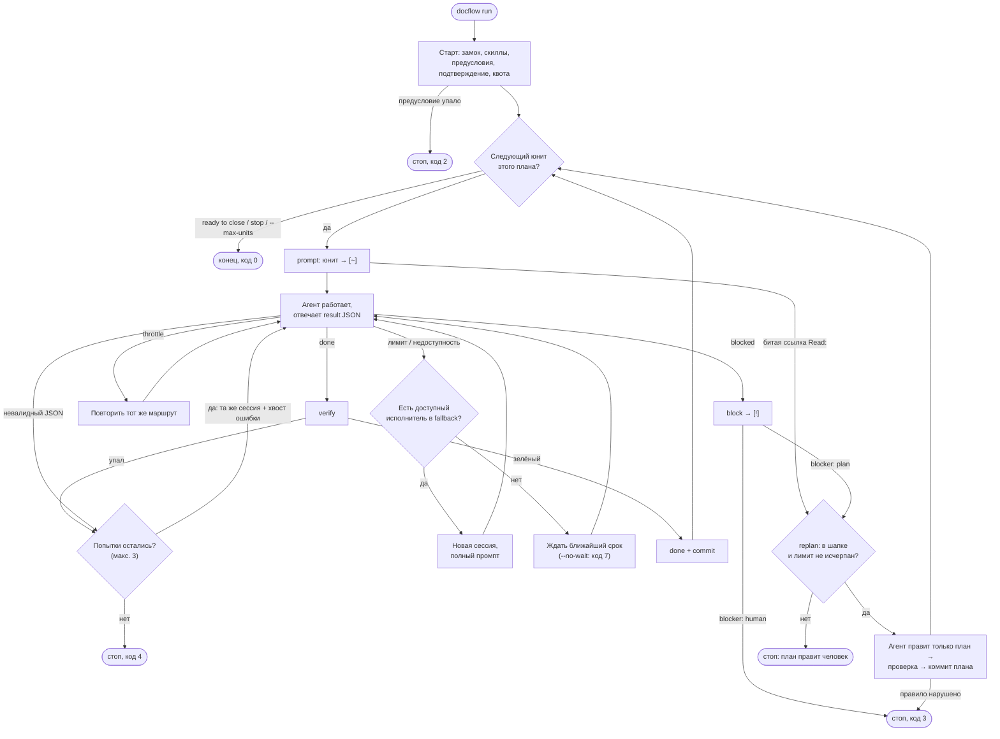

# Раннер

`docflow run` ведёт юниты текущего плана агентом без человека. Агент
только делает работу и возвращает result JSON; механику (`prompt`,
`verify`, `done`, `commit`, `block`) раннер запускает подпроцессом своего
же скрипта — те же проверки порядка и коды, что у человека. Почему —
[P006](../archive/P006-runner.md).



Схема без кодов 5 и 7 и остановки сигналом — они ниже.

Цикл на юнит:
1. `docflow prompt <id>` → `[~]`. Агенту уходит промпт юнита, где вместо
   `## Cycle` — `## Cycle (runner mode)`, плюс `instructions` профиля
   (только в режиме прав `auto`: они описывают песочницу, которой в
   `full` нет). Режим раннера требует `Verify` и тесты в foreground и не
   заканчивать ответ при живой фоновой задаче или субагенте: `claude -p`
   ждёт её 10 минут и отвечает без result JSON
   ([P019](../archive/P019-runner-background-tasks.md)).
2. Result JSON `blocked` → `docflow block --needs <класс> --reason`, код 3
   (`blocker: plan` — триггер авто-replan, см. ниже). После красной строки
   остановки на `needs human` — строка с командой `docflow unblock <id>
   --note "…", then docflow run`. Если первый выбор прогона — юнит `[!]` с
   блоком `needs human`, то в терминале и без `--yes` прогон печатает причину
   и спрашивает `done? [y/N] `: на `y` читает одну строку заметки, снимает
   блок командой `unblock` (она не коммитит), выбирает юнита заново и
   продолжается обычный старт — prerequisites, подтверждение, квоты; на `n`,
   без терминала или с `--yes` — тот же стоп с кодом 3 и командой. Спрашивается
   только первый выбор: блок в середине прогона останавливает его, а человек
   присутствует ровно когда запускает `run` (терминал — и консоль Windows:
   строка ввода определяется по console handle, перенаправленный файл и pipe
   терминалом не считаются). Ctrl-C во время любого из двух чтений останавливает
   прогон кодом сигнала (130): вопрос обрывается на своей строке, `unblock` не
   вызывается, план не меняется, агент не запускается; ответ и заметка, пришедшие
   после отмены, проверяют контекст до снятия блока и не применяются
   ([P041](../archive/P041-human-unblock.md)). `done` →
   `verify`; зелёный → `done` с handoff и decisions из JSON → `commit`.
   Для итераций агент запускает `Verify:` юнита или `docflow verify <id>
   --no-gate`; перед ответом выполняет один полный `docflow verify <id>`.
   Длинные проверки не нужно обрезать через `tail`/`grep`: полный stdout и
   stderr сохраняются в `<git-dir>/docflow/run/<id>.verify.log`, путь `log:`
   печатается последней строкой ошибки. Если дерево не изменилось после
   полного verify агента, раннер переиспользует запись; `--skip` не подходит
   ([P032](../archive/P032-runner-fallback.md)).
3. `preflight`, `Verify`, `gate` или commit-hook упал, либо result JSON невалиден → та же сессия
   (`resume_args`) получает хвост вывода или причину; сессии нет — полный
   промпт и раздел `## Previous attempt`. Не больше `--attempts` (3)
   вызовов на юнит; исчерпано — юнит остаётся `[~]` либо ждёт завершения
   коммита, код 4 (проверка или хук) или 7. Ошибки Git вне хуков, включая
   подпись и права доступа, останавливают запуск без повторного вызова агента.
   Не `block`: `[!]` значит «план устарел».
4. `prompt` следующего юнита отверг ссылку `Read:` (файл переименован
   прошлым юнитом) → код 2 и строка «replan»: триггер авто-replan; без
   ключа `replan:` план правит человек.
5. Код 5 — агент закоммитил файл плана, переписал историю или сменил
   статус юнита. Прочие коммиты за время вызова (например, пины от
   инструмента выпуска) — строка-предупреждение, юнит продолжается
   ([P012](../archive/P012-runner-foreign-commits.md)). Вложенные репо из
   `repos:` проверяются так же: перезапись истории в них — код 5,
   коммиты агента — предупреждение с префиксом `<path>:`.
   Предохранитель до этого стопа: процесс агента получает
   `DOCFLOW_RUNNER_UNIT=<id>`, и `finish`, `done`, `commit`, `block` в нём
   отказывают с кодом 5 — запрет в промпте слабая модель нарушает.
   `docflow run` сбрасывает переменную: вложенный раннер (тесты) свой.

В режиме исполнителей плановый `fallback:` задаёт маршруты по порядку.
После отказа `limit` или `outage` раннер помечает маршрут недоступным по
ключу `agent|model` и сразу пробует первый доступный. Переключение создаёт
новую сессию и полный промпт с `## Previous attempt`: `git diff --stat HEAD`
и untracked-пути из `git status --porcelain` (до 40 строк, при усечении —
`… N more`), затем до трёх последних текстовых сообщений ассистента из
stdout отказавшего вызова. Сообщение, несущее отказ, исключается; каждое
сообщение обрезается до 600 символов. Если формат не дал сообщений,
`### Last messages` не добавляется
([P038](../archive/P038-runner-backlog-batch.md)). Работа в дереве сохраняется, отказ не
расходует попытку юнита. `throttle` повторяет тот же маршрут. Если
недоступна вся цепочка, раннер ждёт ближайший срок сброса;
`--no-wait` останавливает прогон с кодом 7, оставляя юнит `[~]`. Каждый
новый юнит начинает выбор с основного маршрута, если срок его недоступности
уже прошёл.

Авто-replan: план с ключом `replan: agent | model | effort` в шапке чинит
себя без человека. Триггеры — `blocked` с `blocker: plan` и отказ
`prompt` по ссылке `Read:`/Context (код 2); `blocker: human` и
исчерпанные попытки (код 4) — стоп без replan. Строка `<id> replan ->
agent | model | effort`, снимок дерева без файла плана и текста плана,
затем вызов агента маршрута `replan:` с промптом replan (правила:
править только план, снять блок — `[~]` над незакоммиченной работой,
`[ ]` над чистым деревом, не коммитить; список незакоммиченных файлов
в промпте; правила полны без скилла `bsv-docflow-plan`, которого у
агента может не быть) теми же механизмами, что юнит:
попытки, таймаут, ожидание лимита, отказ авторизации, режим прав плана,
`DOCFLOW_RUNNER_UNIT`, лог `<id>.replan<N>.out`; `N` следует за уже
записанными логами replan этого юнита. Ответ `blocked` — стоп,
код 3. Ответ `done` — HEAD не сдвинулся (коммит агента опустошает
`git diff HEAD` и потому невидим отпечатку дерева), дерево вне плана
не изменилось и `check_replan` пуст (шапка, Goal, Constraints,
Prerequisites и юниты `[x]`/`[-]` не тронуты, id юнитов на месте,
`lint` чист, юнит больше не `[!]`), план изменён, ссылки `Read:`/Context
юнита существуют и юнит не `[ ]` над незакоммиченной работой — иначе
следующий `prompt` отказал бы снова, а replan был бы потрачен на
пустой коммит: раннер коммитит план (`Pxxx: replan
Pxxx.N.M`, только файл плана), печатает
`<id> replanned: <sha> (+N units)`, и цикл берёт юнит заново — коммит
replan сдвигает HEAD, поэтому базу проверки чужих коммитов каждый юнит
берёт заново после него. Нарушение любого правила — план
восстанавливается текстом до вызова, проблемы печатаются, код 3.
Лимиты: 2 replan на юнит, `--replans N` (по умолчанию 3) на фазу плана
([P037](../archive/P037-replan-phase-limit.md));
превышение или план без `replan:` — прежний стоп со строкой `replan
limit reached`. В режиме исполнителей replan идёт по цепочке `replan:` —
полной, без добавления `fallback:`. Отказ `limit` или `outage` переводит
на следующий доступный маршрут с новой сессией и полным промптом;
`throttle` повторяет тот же маршрут. Квота проверяется по стартовому
замеру и накопленным событиям без повторного зонда. Если вся цепочка
недоступна, replan ждёт ближайший срок;
`--no-wait` оставляет план без изменений. Строка квоты печатается и после
вызова replan, итоговая строка прогона показывает число replan и смен
исполнителя: `, N replans, M switches`
([P025](../archive/P025-autonomous-run.md)).

Незавершённый коммит имеет приоритет перед следующим юнитом: `run` повторяет
проверки и завершает его, без агента при успехе. При отказе проверки или хука
агент получает причину; уже созданные коммиты не переписываются.

Граница плана: раннер берёт следующий юнит, пока это тот же план; план
стал `ready to close` → код 0. С `--close` раннер поручает закрытие агенту
по `bsv-docflow-close`; это работает и при старте с уже готовым планом.
Маршрут — полная цепочка `cheap:`, а без неё — шапочные `executor:` +
`fallback:` (у legacy-плана — маршрут по умолчанию)
([P038](../archive/P038-runner-backlog-batch.md)). Отказы, ожидание и
смена исполнителя работают как у юнитов. Агент сам вызывает `docflow close
<id>` и заполняет архив; каталог исполняемого раннера добавляется в `PATH`
вызова, если отсутствует. Раннер требует чистое дерево перед закрытием и
проверяет после ответа: файл плана удалён, `docs/archive/<id>-*.md` существует,
`docflow lint` без ошибок, изменённые пути — только `docs/`, `CHANGELOG.md`,
`README.md`, `README.ru.md`. Успех — коммит `<id>: close plan`; провал
проверок — код 2 со списком проблем, дерево остаётся как есть. Логи закрытия —
`<id>.close<N>.out`, нумерация продолжается при повторном запуске.
`--dry-run --close` допечатывает маршрут `close:`.
`--max-units N` — стоп раньше; запрос остановки не запускает закрытие. Один
раннер на репозиторий: замок `<git-dir>/docflow/run/run.lock`, занят живым
процессом → код 2. Лог каждого вызова агента —
`<git-dir>/docflow/run/<id>.<n>.out`; `n` следует за уже записанными логами
этого юнита, поэтому повторный `docflow run` не перезаписывает вызов.

Рядом с логами раннер пишет поток событий
`<git-dir>/docflow/run/<run-id>.events.jsonl`
([P038](../archive/P038-runner-backlog-batch.md)). `run-id` — время старта в UTC,
например `20261025T101500Z`; при занятом имени добавляется `-2`, `-3` и далее.
Каждая строка — отдельный JSON-объект, записанный и сброшенный на диск сразу.
`--dry-run` поток не создаёт. Ошибка создания, записи или сброса даёт одну
строку предупреждения и отключает поток до конца прогона; код выхода раннера
от неё не меняется. Логи вызовов по-прежнему требуют доступного каталога.

Общие поля: `v: 1`, `ts` — epoch seconds с дробной частью, `run` — run-id,
`event` — имя события; `unit` — ID юнита, когда событие к нему относится.
Маршрут — объект `{"agent":"…","model":"…","effort":"…"}`.

| `event` | Дополнительные поля |
|---|---|
| `run_start` | `plan` — ID плана, `units` — полное число его юнитов |
| `unit_start` | `route` — выбранный маршрут |
| `attempt` | `n` — номер попытки, `route`, `log` — путь лога относительно корня репозитория |
| `quota` | `name` — провайдер, `windows` — массив объектов `label`, `used` (проценты), `reset` (сырое значение или `null`) |
| `route_switch` | `from`, `to` — маршруты, `kind` — класс отказа |
| `replan` | `route` — последний маршрут, `result` — результат, `exit_code` |
| `close` | `plan` — ID плана, `route` — последний маршрут, `result`, `exit_code` |
| `verify` | `exit_code`; `reused: true`, если проверка агента переиспользована |
| `commit` | `sha` — hash коммита |
| `unit_end` | `status`, `seconds` — время всего юнита, `cost` — сумма стоимости вызовов, если известна |
| `run_end` | `reason` — причина остановки, `exit_code` — итоговый код раннера |

`status` и `result`: `done`, `blocked`, `failed` или `error` (ошибка самого
вызова раннера). Событие `replan` завершает операцию replan; её `attempt`,
`route_switch` и `commit` дополнительно несут `replan: true`. Закрытие даёт
такие же события; его `attempt`, `route_switch` и `commit`
несут `close: true` и `plan` вместо `unit`, событие `close` завершает операцию.
Отказ провайдера не увеличивает `n`: следующий вызов остаётся той же попыткой.
Стартовые замеры `quota` и квоты закрытия не несут `unit`, остальные
относятся к текущему юниту.
`unit_end` записывается и при неудаче, `run_end` — также при остановке сигналом;
до получения замка и прохождения стартовых проверок поток ещё не открыт.

Обещание версии `v`: в рамках версии 1 имена событий, типы и смысл
описанных полей сохраняются; новые поля и события могут добавляться.
Читатель игнорирует неизвестные поля и события. Несовместимое изменение
схемы требует нового значения `v`; версия формата плана от неё не зависит.

Старт прогона: сначала проверка скиллов docflow у каждого агента плана
(исполнители открытых юнитов и `replan:`) — как `doctor`: личный или
проектный каталог, копия равна `skills/` или ссылка на него. Нет или
устарел — жёлтая строка `skills: <агент>: not installed …; stale …;
update: …`, не стоп: цикл юнита и правила replan целиком в промпте
раннера; `DOCFLOW_SKILLS_CHECK=0` выключает ([P027](../archive/P027-skills-check-symlinks.md)). Затем план
объявляет режим прав `permissions: auto|full`
(нет ключа — `auto`) и предусловия `## Prerequisites`
([формат](format.md#план)). Раннер выполняет команды предусловий из корня
репозитория (таймаут 60 с, stdin закрыт: команда, ждущая ввода,
падает, а не висит) до квоты и агентов; провал или таймаут — код 2 со
строкой `prerequisite failed: <текст> (<команда>, exit N|timeout)` и
последней строкой вывода команды на каждый пункт. На начатом плане
предусловие с меткой `(once)` пропускается с выводом `prerequisite skipped
(once, plan started): <текст>`; оно не попадает в подтверждение старта
([P033](../archive/P033-prereq-once.md)).
После фильтрации, если план не просит `full` и не осталось предусловий без
команды, вопрос не задаётся. Иначе раннер печатает их и спрашивает один
раз `continue? [y/N]` — до `no_echo` и потока клавиш,
иначе их ввод съест ответ; `--yes` отвечает «да», stdin не TTY без `--yes`
— код 2, ответ «n» — код 1, ничего не запущено. Секция Prerequisites
целиком входит в промпт каждого юнита. Аргументы режима — таблица
`permissions` профиля, не код по имени агента; профиль без таблицы в
`auto` идёт с `cmd` как есть, `full` — ошибка до запуска (код 2)
([P025](../archive/P025-autonomous-run.md)).

В режиме исполнителей стартовый замер квоты включает маршруты `fallback:`
и replan, если у их профилей есть `quota`. Окно с использованием не ниже
100% и сбросом в будущем сразу помечает соответствующий `agent|model`
недоступным до сброса. Перед каждым юнитом раннер повторяет эту проверку по
квоте, накопленной из потока уже вызванных агентов, без нового зонда; строки
`<agent>: quota exhausted until HH:MM, skipped` показывают пропущенные
маршруты. Если вся цепочка недоступна, раннер ждёт ближайший срок, а
`--no-wait` завершает запуск с кодом 7.

Result JSON — единственный контракт с ассистентом:
`{"status": "done"|"blocked", "handoff": [...], "decisions": [...],
"unverified": [...], "reason": "...", "blocker": ""|"plan"|"human"}`.
У `done` handoff непустой и `blocker` пустой; у `blocked` есть reason, а
`blocker` называет того, кто снимает блок: `plan` — править план
(готовится авто-replan), `human` — нужен человек: вход, доступ, секрет,
устройство, решение. Ответ без поля (JSON-блок из текста) читается
по-старому: `blocked` считается `human`. `unverified` уходит в Handoff
с префиксом
`Unverified: `, печатается жёлтым после юнита, счётчик — в итоговой строке.
Раннер считает только оставшиеся пункты: перед записью в Handoff он выбрасывает
пункт, нормализованный текст которого совпал с пунктом `Unverified:` в Handoff
прямых `Depends` (нормализация: нижний регистр, сжатые пробелы, знак в конце;
хвост `( … )` срезается только когда это пометка наследования — начинается с
`inherited` или содержит id юнита, а скобка с собственной деталью пункта
(`layout on iPhone (small)`) остаётся в ключе с обеих сторон) — копия держала
бы один риск открытым юнит за юнитом; при `--verbose` раннер печатает
`unverified: N repeated from Depends dropped`
([P044](../archive/P044-unverified-discipline.md)).
Значение поля — [«Цикл юнита»](cycle.md#цикл-юнита).
Берётся из поля вывода `result` профиля, иначе — последний блок
` ```json ` в тексте ответа (ассистенты без JSON-схем), иначе — голый
объект с ключом `status`, которым заканчивается ответ (малые модели,
например GLM-flash под Pi, пропускают ограждение блока, и попытки
сгорали на «no result JSON»).

Конфиг — TOML, накладывается на встроенные профили по ключам; новый
ассистент — конфиг, не код. Ключи профиля, плейсхолдеры, порядок поиска
файла и коды выхода — [usage.md](../usage.md#автозапуск).

Маршрут юнита — ассистент, модель и усилие рассуждения. План с
исполнителями ([формат](format.md#план)) задаёт его сам: тройка юнита, иначе
шапки. Такой прогон берёт только встроенные адаптеры `claude`/`codex` — без
пользовательского файла, `$DOCFLOW_AGENTS` и XDG-конфига; `--config`,
`--agent`, `--model`, `--effort` отвергаются до запуска (код 2): исполнителя
меняют в плане. Ошибка назначения останавливает прогон до квоты и агента.
Режим решается по плану до чтения конфига; dry-run, стартовая квота,
продолжение сессии и повторы берут один и тот же маршрут. Встроенный
адаптер отвечает за способ вызова, план — за выбор
([P021](../archive/P021-plan-executors.md)). `run --dry-run --all` проверяет
маршруты оставшихся юнитов без агентов; `--plan` — только для dry-run, чтобы
проверить draft или отложенный план, а не обойти очередь в прогоне.

План без исполнителей (legacy) считает маршрут по
ярусу `fast|default|strong|max` из верхней таблицы `[tiers.<ярус>]`
(`agent`, `model`, `effort`). Ярус: `--model`, если это ярус, иначе
`Model:` юнита, иначе `default`; значение не из ярусов — id модели,
ассистент и усилие берутся из яруса `default`. `--agent` подменяет
ассистента и вместо `model` и `effort` яруса берёт `model` профиля (id из
`--model` остаётся); `--effort` перекрывает усилие. Маршрут считается на
каждый юнит: Claude Code и Codex CLI смешиваются в одном прогоне. Ярусы
держат план переносимым между ассистентами
([P015](../archive/P015-multi-agent-runner.md)). Явно названный файл конфига
(`--config`, `$DOCFLOW_AGENTS`), которого нет, — ошибка; нет файла по
умолчанию — встроенные профили.

## Резервные маршруты и таймаут

В плане с исполнителями `fallback:` задаёт упорядоченную цепочку полных
маршрутов после основного маршрута юнита. Отказ основного исполнителя
переключает вызов на следующий доступный маршрут с новой сессией и полным
промптом. Раннер ждёт лимит только после того, как отказала вся цепочка;
порядок маршрутов и их формат описаны в [формате плана](format.md#план).
`run --dry-run --all` печатает цепочки после маршрутов юнитов. Почему так
устроены цепочка, классы отказов и ожидание — ([P032](../archive/P032-runner-fallback.md)).

Юнит с `Role:` использует цепочку соответствующего ключа роли и не добавляет
к ней `fallback:`; юнит с `Executor:` или унаследованным `executor:` сохраняет
обычную цепочку. `replan:` задаёт отдельную цепочку, также без `fallback:`
([P036](../archive/P036-roster.md)).
Стартовый замер квоты и пропуск исчерпанных маршрутов действуют на все
цепочки одинаково — роль юнита, `fallback:` и `replan:`. В
`run --dry-run --all` маршрут юнита с ролью помечен источником
`role <имя>`, после маршрутов юнитов печатаются цепочки `fallback:`,
ключей ролей из шапки и `replan:`.

`timeout:` в шапке задаёт стенное время одного вызова агента в секундах и
перекрывает профильный `timeout` для юнитов и replan. Диапазон — 60–86400;
без ключа плана действует таймаут профиля. Проверка `Verify` и gate не
ограничиваются этим ключом: он относится к вызову агента.

Живость вызова раннер читает из потока событий агента, который он и так
разбирает построчно: по формату `stream` считаются ходы и инструменты в
работе (`claude` — ход это событие `assistant`, инструмент — блок `tool_use`
до парного `tool_result`, `StructuredOutput` не инструмент, событие `result`
закрывает все инструменты; `codex` — ход это `turn.started`, инструмент —
не-молчаливый `item.started` по `item.id` до `item.completed`; `pi` — ход это
`message_end` с `role=assistant`, инструмент — `tool_execution_start` /
`tool_execution_end` по `toolCallId`). Профильный `idle_timeout` — лимит
тишины: без новой строки потока и без инструмента в работе вызов снимают как
зависший (встроенные профили — 1200 с; 0 выключает проверку, диапазон
5–86400). Инструмент в работе никогда не простой, он ограничен только
жёстким лимитом `timeout` (встроенные профили — 7200 с): долгий `go test`
событий не печатает. Выборка простоя идёт раз в 2 с, поэтому сигнал
зависания наступает до 2 с после превышения лимита; снятие — то же дерево
процессов, что и по таймауту, попытка считается и повторяется.

У истечения лимита два исхода. Простой по `idle_timeout` — строка проблемы
`agent silent for <idle>, no tool running — stopped`; попытка повторяется как
по таймауту: та же сессия, в промпт идёт заметка о зависании. Таймаут
`timeout`, наступивший при активной работе — последние события моложе 60 с
или инструмент в работе, — это не отказ: жёлтая строка
`↻ attempt N: time cap <cap> reached while active (<turns> turns); resuming
the session`, а с инструментом в работе она называет его —
`time cap reached during <activity>`; попытка продолжается на той же сессии,
а в итоге прогона появляется строка
`hint: <id> needs more than <cap> on <route>: split the unit or set timeout:
in the plan header`. Агент, молчавший весь вызов, активным не считается: для
него остаётся строка проблемы `timed out after <timeout> s` без подсказки.
Вызов закрытия отчитывается так же: при активной работе — строка
`↻ close attempt N: time cap …` с подсказкой в итоге и продолжение на той же
сессии, молчаливый вызов сохраняет строку `close agent timed out`.

Классификатор отказов запускается только для ответа с ошибкой (`error` или
ненулевой код); таймаут, вызов, снятый по `idle_timeout`, и обычный ответ с
цитатой «rate limit» не считаются отказом — вывод прерванного вызова цитирует
лимит и текст логина, а маршрут при этом исправен, и такой вызов уходит на
повтор попытки, а не на резервный маршрут. Сначала проверяются признаки
встроенного исполнителя, затем — regex `limit` пользовательского профиля для
legacy-режима.

В режиме исполнителей `limit` и `outage` помечают маршрут (`agent|model`)
недоступным до срока из колонки «Реакция» и переключают вызов на следующий
доступный маршрут цепочки; ожидание из таблицы наступает, только когда
недоступны все маршруты, — тогда раннер ждёт ближайший срок. `throttle`
всегда остаётся на том же маршруте.

| Класс | Признаки и источник | Реакция |
|---|---|---|
| `limit` | Claude: `rate_limit_event` со `status: rejected` даёт `resetsAt`; текст `rate_limit_error` или HTTP 429 ([ошибки Anthropic](https://docs.anthropic.com/en/api/errors), [событие Claude Code](https://github.com/anthropics/claude-code/issues/91857)). Codex: `rate_limit_reached_type` или окно `used_percent` ≥ 100 в rollout-файле ([парсер CodexLimits](../../internal/agentio/quota.go), [типы ошибок Codex](https://github.com/openai/codex/blob/main/codex-rs/protocol/src/error.rs)); текст `usage limit`, `usage_limit_reached` или HTTP 429. Pi: коды z.ai 1308/1310 или другой HTTP 429 ([ошибки z.ai](https://docs.z.ai/api-reference/api-code), [формат JSON-событий Pi](https://github.com/earendil-works/pi/blob/main/packages/coding-agent/docs/json.md)); образец 1310 — [сохранённый ответ](../../internal/agentio/testdata/pi-limit-zai.jsonl). | Ждать до сброса + 60 с, затем продолжить ту же сессию; без времени сброса использовать `limit_wait`. Для кода z.ai время без зоны трактуется как UTC+8. |
| `throttle` | Pi: код z.ai 1302 (`Rate limit reached for requests`, [таблица ошибок z.ai](https://docs.z.ai/api-reference/api-code)). | Повторить через 30 с в той же сессии; четвёртый подряд throttle становится `outage`. |
| `outage` | Claude: `overloaded_error`, HTTP 529/5xx или `api_error` ([ошибки Anthropic](https://docs.anthropic.com/en/api/errors)). Codex: `stream disconnected`, overloaded или 5xx ([типы ошибок Codex](https://github.com/openai/codex/blob/main/codex-rs/protocol/src/error.rs)). Pi: код z.ai 1305 (временно перегружен), HTTP 5xx или `fetch failed`, `ECONNREFUSED`, `connection error`, `terminated` ([ошибки z.ai](https://docs.z.ai/api-reference/api-code), [формат JSON-событий Pi](https://github.com/earendil-works/pi/blob/main/packages/coding-agent/docs/json.md)). | Повторить через 10 мин в той же сессии. |

Ни один класс не тратит попытку; `LimitTries` считает подряд отказы всех
классов. `--no-wait` или 10 отказов подряд останавливают раннер с кодом 7.
Сигнатуры применяются только к ошибке, чтобы не принять обычный ответ,
цитирующий файл про «rate limit», за отказ провайдера.

Нет авторизации: строка ответа с ошибкой совпала с `auth` (без учёта
регистра; `claude` — «Failed to authenticate», «Not logged in», `codex` —
«401 Unauthorized», «codex login») → `<id>: <агент> is not logged in:
<строка>`, код 7 без повторов: попытки на это тратить незачем, юнит
остаётся `[~]`. Остальные отказы агента пишут в строку попытки первую
строку ответа, ошибки или stderr — причина видна без лога вызова.

Таймаут: перед сигналом раннер снимает дерево процессов по `PPID`, посылает
SIGTERM группе агента и группам найденных потомков; через 10 с посылает
SIGKILL тем же группам и PID снимка, не затрагивая группу самого раннера
([P032](../archive/P032-runner-fallback.md)).
На Windows групп и сессий нет: `Kill` запускает `taskkill /T /F /PID` для
агента (дерево по родительским PID), при ошибке `taskkill` убивает только
процесс агента и ждёт его выхода до 10 с, затем добавляет `Process.Kill`
([P040](../archive/P040-windows-support.md)). Исполняемый файл агента ищет
`exec.LookPath` по `PATHEXT` (`claude.exe`, `.cmd`-шим); промпт идёт в stdin,
пути в нём — как их видит агент. Блокировка `run.lock` проверяет PID через
`OpenProcess`; уведомления рабочего стола на Windows нет, ошибки тоже: при
терминале звенит `\a`.
Потомок, ушедший к init до снимка, сигнала не получает; если он держит
stdout или stderr агента, вызов после выхода агента ждёт их закрытия не
дольше 5 с, иначе раннер висел бы, пока жив потомок. Таймаут считается
попыткой. Агент живёт в своей сессии и сигналы терминала не получает: Ctrl-C, SIGTERM и SIGHUP (закрытый терминал) раннер ловит сам и
останавливает то же дерево; юнит остаётся `[~]`, код 128 + номер сигнала.
Мягкая остановка — файл `<git-dir>/docflow/run/stop` (`s` + Enter в
терминале раннера или `docflow run --stop`): раннер проверяет его между
юнитами и выходит с кодом 0; файл от прошлого запуска удаляется на старте.
Первое `s` раннер подтверждает строкой с id юнита, после которого план
остановится; дальнейший ввод читается и отбрасывается. Эхо терминала на
время прогона выключено (Enter иначе разрывает строку спиннера) и
восстанавливается при любом выходе.

Конец любого прогона, кроме остановки сигналом, уведомляет человека (нужен
и на `ready to close`, и на стопе): darwin — `osascript`, linux —
`notify-send` из `PATH`, без них — `\a` в терминал. Таймаут 5 с, ошибки
игнорируются. Текст: `<план>: ready to close`, `<id> blocked (needs
<класс>): <reason>` или причина остановки. `--no-notify` и
`DOCFLOW_NOTIFY=0` выключают.

В TTY старт, каждый юнит, replan и итоговая сводка выделены блоками с
отступами и переносом длинных сообщений по ширине терминала. Исполнитель
показан отдельной меткой (`Codex`, `Claude`, `Pi`, `Local` или имя профиля), рядом —
модель и цветной уровень reasoning: `low` — серый, `medium` — синий,
`high` — фиолетовый, `xhigh` и `max` — оранжевый, `ultra` — ярко-красный.
Надписи `Codex` и `Claude` белые; фон `Codex` — синий, `Claude` — оранжевый.
Маршруты Pi `strata/<model>` — локальные: метка `Local` с тёмным текстом
на светлосером фоне; остальные модели Pi сохраняют метку `Pi`.
В текстовом выводе локальный маршрут получает префикс `Local:`.
Контракт локальных маршрутов — [P043](../archive/P043-local-worker.md).
Статусы различаются и символами: `✓ Done`, `!` для замечаний, `↻ Replanned`.
Заголовок юнита — `<id>: <название>`. Пустая строка разделяет блоки;
внутри блока строки идут подряд. Переносы, включая `Unverified`, сохраняют
левую рамку и учитывают фактическую ширину терминала. Вывод упавшей
подкоманды (`prompt`, `verify`, `commit`) тоже идёт внутри блока с рамкой;
в текстовом выводе он печатается как есть.
У `Blocked` и `replan Blocked` заголовок красный, причина — белая на
следующей строке с отступом, как у `Unverified`. Каждый начатый блок юнита
или replan завершается строкой `Time: <длительность>` перед квотой при любом
исходе, включая восстановление коммита, ошибку и прерывание. Это время всего
блока, включая попытки и проверки; в текстовом выводе — `<id> time: ...`.

Квоты в TTY подписаны `Quota · used`: полоса — израсходованная доля окна, рядом
точный процент и дельта в процентных пунктах. До 75% полоса зелёная,
с 75% — жёлтая, с 90% — красная. Окна стоят рядом, если ширины хватает,
иначе — на отдельных строках; `--verbose` добавляет строки времени сброса.
Квота закрывает блок юнита, итоговая сводка показывает дельты за весь запуск
(`Δ run`). `NO_COLOR` сохраняет рамки, подписи и символы статусов.

Текстовый вывод (pipe, `> log`, `TERM=dumb`): первая строка
`run: <план>, start HH:MM:SS` (при режиме `full` —
`, permissions full`); юнит — название,
модель, итог (попытки, время, сумма `cost` по вызовам); последняя строка —
`run: N units, HH:MM:SS–HH:MM:SS (<длительность>), $<сумма>` и квота по
агентам `claude 5h NN% (+D) · 7d NN% (+D)` (агенты через `; `), если
известна. После каждого юнита, при любом исходе (готов, блок, отказ, чужой
коммит, сигнал), без `-v` печатается `quota: <агент> 5h NN% (+D) · 7d NN%
(+D)` — изменение квоты за юнит. Сразу после первой строки — `quota:
<агент> 5h NN% · 7d NN%` по агентам оставшихся юнитов и агенту `replan:`,
если авто-replan в прогоне возможен (через `; `): их
опрашивает команда профиля `quota` без вызова модели (`claude -p /usage`,
`codex app-server` → `account/rateLimits/read`); для `pi` с моделью
`zai/...` встроенный зонд получает ключ командой
`pi auth print-api-key --provider zai` и запрашивает API z.ai; он повторяется
после каждого вызова, поскольку поток Pi квоту не содержит
([P035](../archive/P035-zai-quota.md)). Сбой зонда —
агента нет в строке. У локальных `pi | strata/<model>` квоты нет:
команда `quota` профиля не вызывается, окна из потока игнорируются,
квота облачных моделей Pi локальный маршрут не блокирует.
Резервные облачные маршруты по-прежнему опрашиваются.
Дельты считаются от этого замера, без него — от первого
`rate_limit_event` агента в прогоне; окно сбросилось (время сброса сдвинулось
больше чем на 10 минут) — без дельты
([P018](../archive/P018-run-start-quota.md)). Итоговая сводка печатается при любой остановке (блок,
отказ, сигнал). `-v/--verbose` добавляет приглушённые строки: номер юнита,
`Verify`, попытку и лог, токены и ходы, к строке квоты — время сброса,
оценку остатка, таблицу юнитов. Спиннер (в verbose — с последним действием
агента) и цвета — только когда stdout это TTY и `TERM` не `dumb`;
`NO_COLOR` отключает цвета. Квоту Codex даёт не поток, а rollout-файл
`$CODEX_HOME/sessions/*/*/*/rollout-*-<thread_id>.jsonl` (последний
`token_count` с `rate_limits`; окна `primary` и `secondary` подписаны по
`window_minutes`: 300 → `5h`, 10080 → `7d`), читается после каждого вызова.
Квоту и действие Claude даёт декодер потока
`stream = "claude"` из `rate_limit_event` (`--output-format stream-json`);
профиль без `stream` их не показывает
([P011](../archive/P011-runner-output.md)).

Профиль `claude`: `claude -p --output-format stream-json --verbose
--json-schema {schema}`; аргументы режима прав добавляет таблица
`permissions` профиля: `auto` — `--permission-mode auto
--permission-prompts none`, команды агента
проверяет классификатор `auto`; `full` — `--permission-mode
bypassPermissions`. Haiku `auto` не поддерживает и без явных
прав получает отказ на любую запись: `model_extra` даёт ему
`--allowedTools Write Edit Bash` ([P007](../archive/P007-auto-permission-mode.md))
по точному имени — ярусу `haiku` и полному `claude-haiku-5-5` из `Executor`.
`--bare` не годится: не берёт логин подписки. Нужен собственный вход CLI
(`claude auth login`).

Профиль `pi`: `pi -p --mode json`, промпт в stdin; модель `--model
<provider/id>` из тройки как есть (каталога моделей в коде нет), усилие —
`--thinking`, продолжение — `--session <id>` из события `session`. Права:
у Pi нет песочницы и подтверждений инструментов, `auto` не добавляет
аргументов, `full` добавляет `--approve` — доверие проектным файлам
(`.pi/skills/`, расширения). Декодер
`stream = "pi"` сворачивает JSON Lines в объект `session`, `text` (последний
`message_end` с `role: assistant`), `usage` и `cost` (суммы по всем
assistant `message_end`: каждый — отдельный вызов API), `is_error` (true, пока
не было assistant `message_end`, при `stopReason: "error"` в нём и при
`agent_settled.aborted`), `error` (`errorMessage`: ошибка API может выйти с
кодом 0, классификатор читает её из этого поля). Токены —
`input + cacheRead + cacheWrite`, не `totalTokens` (в нём reasoning). Ключа
`quota` у Pi нет; исключение — модель `zai/...`: квота зондируется встроенно,
ключ профиля не нужен. Regex `limit` сохраняется для пользовательского
конфига; `auth` — только
`no api key found` ([P026](../archive/P026-pi-agent.md)).

Профиль `codex`: `codex exec --json --output-schema {schema_file}`,
аргументы режима прав из таблицы `permissions`: `auto` —
`--approve-for-me -c sandbox_workspace_write.network_access=true`,
`full` — `--dangerously-bypass-approvals-and-sandbox`.
Продолжение — `resume <thread_id>` в конце argv, промпт в stdin и там.
Декодер `stream = "codex"` сворачивает JSON Lines в один объект: `thread_id`,
`text` (последний `agent_message`, в нём result JSON), `usage` (последний
`turn.completed`), `is_error`/`error` (`turn.failed` или `error`). Токены —
только `input_tokens`: `cached_input_tokens` уже входят в них. Ответ с флагом
`error` — неудачная попытка, как код ≠ 0. Песочница workspace-write с сетью и
`--approve-for-me` ближе всего к `auto` у Claude: запись вне репозитория
(`~/.gradle`, DerivedData) агент просит с эскалацией, и её проверяет
автоматический ревьюер; об этом говорит `instructions` профиля
([P015](../archive/P015-multi-agent-runner.md)) — она уходит агенту
только в режиме `auto`: в `full` песочницы нет. `--output-schema` строгий:
все ключи `RESULT_SCHEMA` обязательны, неиспользуемые — пустой список или
строка; одна схема на всех ассистентов, Claude её тоже принимает.
