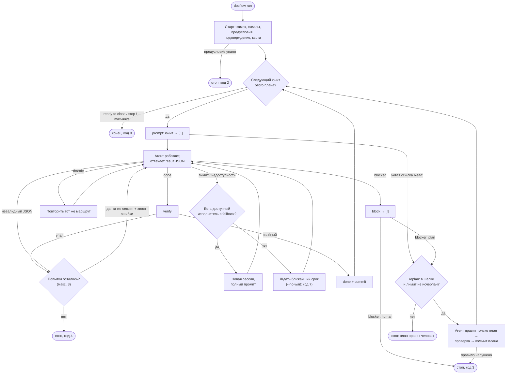

# Раннер

`docflow run` ведёт юниты текущего плана агентом без человека. Агент
только делает работу и возвращает result JSON; механику (`prompt`,
`verify`, `done`, `commit`, `block`) раннер запускает подпроцессом своего
же скрипта — те же проверки порядка и коды, что у человека. Почему —
[P006](../archive/P006-runner.md). Флаги, коды выхода, ключи профиля и
плейсхолдеры — справочник [usage.md](../usage.md#автозапуск); здесь —
устройство и решения.



Схема без кодов 5 и 7 и остановки сигналом — они ниже.

## Цикл на юнит

1. `docflow prompt <id>` → `[~]`. Агенту уходит промпт юнита с `## Cycle
   (runner mode)` вместо `## Cycle` и `instructions` профиля (только в
   `auto`: они описывают песочницу, которой в `full` нет). Режим раннера
   требует `Verify` и тесты в foreground и не заканчивать ответ при живой
   фоновой задаче или субагенте: `claude -p` ждёт её 10 минут и отвечает без
   result JSON ([P019](../archive/P019-runner-background-tasks.md)).
2. `blocked` → `docflow block --needs <класс> --reason`, код 3 (`blocker:
   plan` — триггер авто-replan). На `needs human` после строки остановки —
   `docflow unblock <id> --note "…", then docflow run`. Спрашивает только
   первый выбор прогона на таком юните `[!]` (терминал, без `--yes`):
   `done? [y/N] `, на `y` — строка заметки, `unblock` (не коммитит), выбор
   заново и обычный старт; иначе — стоп с кодом 3. Блок в середине прогона
   останавливает его: человек рядом ровно когда запускает `run`. Терминал —
   и консоль Windows (по console handle; файл и pipe — нет). Ctrl-C во время
   чтения — код 130, `unblock` не вызывается, план не меняется, поздний ответ
   не применяется ([P041](../archive/P041-human-unblock.md)).
3. `done` → `verify`; зелёный → `done` с handoff и decisions из JSON →
   `commit`. Для итераций агент запускает `Verify:` или `docflow verify <id>
   --no-gate`, перед ответом — один полный `docflow verify <id>`. Обрезать
   вывод через `tail`/`grep` не нужно: полный вывод — в
   `<git-dir>/docflow/run/<id>.verify.log`, путь `log:` — последней строкой
   ошибки. Дерево не изменилось после полного verify агента — раннер
   переиспользует запись; `--skip` не подходит
   ([P032](../archive/P032-runner-fallback.md)).
4. Упал `preflight`, `Verify`, `gate` или commit-hook, либо result JSON
   невалиден → та же сессия (`resume_args`) получает хвост вывода или
   причину; без сессии — полный промпт и `## Previous attempt`. Не больше
   `--attempts` (3) вызовов на юнит; исчерпано — юнит `[~]` (или ждёт
   завершения коммита), код 4 (проверка или хук) или 7. Ошибки Git вне хуков
   (подпись, права) останавливают запуск без повторного вызова. Не `block`:
   `[!]` значит «план устарел».
5. `prompt` следующего юнита отверг ссылку `Read:` → код 2 и строка
   «replan»: триггер авто-replan; без маршрута replan план правит человек.
6. Код 5 — агент закоммитил файл плана, переписал историю или сменил статус
   юнита. Прочие коммиты за вызов (пины инструмента выпуска) —
   предупреждение, юнит продолжается
   ([P012](../archive/P012-runner-foreign-commits.md)); во вложенных репо
   `repos:` так же: перезапись истории — код 5, коммиты — предупреждение с
   префиксом `<path>:`. Предохранитель до этого стопа: агент получает
   `DOCFLOW_RUNNER_UNIT=<id>`, и `finish`, `done`, `commit`, `block` в нём
   отказывают кодом 5 — запрет в промпте слабая модель нарушает. `docflow
   run` сбрасывает переменную: вложенный раннер (тесты) свой.

### Граница песочницы

Песочница `permissions: auto` ограничивает только процесс агента.
`preflight`, `Verify:` и `gate:` раннер запускает сам, вне песочницы, с
правами пользователя из корня репозитория — то есть исполняет код, который
агент только что написал (тесты, скрипты сборки, хуки). Границей доверия
служит репозиторий, а не режим прав. Недоверенные планы и репозитории —
`docflow run` целиком в контейнере или под отдельной учётной записью;
раннер такую изоляцию не создаёт и не требует. `full` снимает и песочницу
агента и держится только на `continue? [y/N]` (`--yes` его пропускает),
поэтому для многочасовых прогонов с `full` изоляция обязательна.

## Смены исполнителя и ожидание лимита

`fallback:` задаёт маршруты по порядку. Отказ `limit` или `outage` помечает
маршрут недоступным по ключу `agent|model`, и раннер сразу пробует первый
доступный: новая сессия, полный промпт с `## Previous attempt` — `git diff
--stat HEAD` и untracked-пути из `git status --porcelain` (до 40 строк, при
усечении `… N more`), `### Last messages` — до трёх последних текстовых
сообщений ассистента отказавшего вызова (без сообщения с отказом, каждое до
600 символов; нет сообщений — нет раздела)
([P038](../archive/P038-runner-backlog-batch.md)).

Рассуждения и вызовы инструментов в дерево не попадают, а без них юнит,
прерванный до правок, для следующего исполнителя не существовал (`(no
tracked diff or untracked paths)`). Поэтому есть `### Last reasoning` — до
трёх последних thinking-блоков (в одну строку, до 800 символов, без блока с
отказом) — и `### Transcript` — путь лога вызова
(`.git/docflow/run/<id>.<n>.out`) с указанием прочитать его, когда дерево не
показывает, что уже проверено. Thinking разбирается у `pi` и `claude` (блоки
`thinking`), `codex` (`item.completed` с `reasoning`), `opencode` (part
`reasoning`) и `dsh` (событие `thinking`); неизвестный формат — раздела нет.

Работа в дереве сохраняется, отказ не расходует попытку; `throttle` — тот же
маршрут; недоступна вся цепочка — ожидание срока, `--no-wait` — код 7.
Новый юнит начинает с основного маршрута, если срок его недоступности прошёл.

## Авто-replan

План с исполнителями чинит себя без человека; replan включён по умолчанию.
`replan: agent | model | effort` в шапке только выбирает маршрут, без ключа
replan идёт по `executor:` + `fallback:` — цепочке юнита без `Role:`; ростер
`run` не читает. Единственный отказ — `--replans 0`; план без исполнителей
или без `executor:` в шапке маршрута не имеет и останавливается. Тот же
маршрут видят стартовая квота, проверка скиллов, событие `config` и
`--dry-run --all` (строка `replan: … (default)`)
([P056](../archive/P056-resilient-runs.md)).

Триггеры — `blocked` с `blocker: plan` и отказ `prompt` по ссылке
`Read:`/Context (код 2); `blocker: human` и исчерпанные попытки (код 4) —
стоп без replan.

Вызов: строка `<id> replan -> agent | model | effort`, снимок дерева без
плана и текста плана, промпт replan. Его правила полны без скилла
`bsv-docflow-plan`, которого у агента может не быть: править только план;
снять блок — `[~]` над незакоммиченной работой, `[ ]` над чистым деревом;
не коммитить; список незакоммиченных файлов — в промпте. Падение, которое
называет триггер (тест, пакет, команда), агент выполняет на HEAD до правки
плана, несколько раз, и пишет команду и результат в `## Decisions`: красное
— юнит ремонта; зелёное блок не снимает — падение юнита не объясняется
нагрузкой, флейком или другой сессией, «не воспроизвелось» не
доказательство; нужен юнит, воспроизводящий падение в условиях юнита (дата,
окружение, порядок тестов), или `blocked` с `blocker: human`
([P056](../archive/P056-resilient-runs.md)). Механизмы те же, что у юнита:
попытки, таймаут, лимит, отказ авторизации, режим прав,
`DOCFLOW_RUNNER_UNIT`, лог `<id>.replan<N>.out` (`N` продолжает записанные).

Ответ `blocked` — стоп, код 3. Ответ `done` принимается, когда:

- HEAD не сдвинулся (коммит агента опустошает `git diff HEAD` и невидим
  отпечатку), дерево вне плана не изменилось, план изменён;
- `check_replan` пуст: шапка, Goal, Constraints, Prerequisites и юниты
  `[x]`/`[-]` не тронуты, id юнитов на месте; у опорных проверок плана
  (`Role: review`, `Role: acceptance`) не тронуты `Verify:`, `Do:`, `Role:`
  и нет перехода в `[-]` (маркер и `Depends:` меняться могут: replan снимает
  блок и добавляет юниты исправления); открытый юнит не переведён в `[x]` —
  раннер `[x]` пропускает, проверка исчезла бы молча; `lint` чист; юнит
  больше не `[!]`;
- ссылки `Read:`/Context юнита существуют и юнит не `[ ]` над
  незакоммиченной работой — иначе следующий `prompt` отказал бы снова.

Тогда раннер коммитит только файл плана (`Pxxx: replan Pxxx.N.M`),
печатает `<id> replanned: <sha> (+N units)` и берёт юнит заново; база
проверки чужих коммитов берётся после коммита replan. Нарушение любого
правила — план восстанавливается текстом до вызова, проблемы печатаются,
код 3.

Смены проверок записывает docflow, а не агент
([P050](../archive/P050-verify-guard.md)): изменённый `Verify:` открытого
юнита и переход в `[-]` дают пункты `## Decisions` `- Replan changed check:
<id> Verify: <старое> -> <новое>` и `- Replan changed check: <id> skipped` в
коммите replan, жёлтую строку `<id> replan changed check: <пункт>`, счётчик
`, N checks changed by replan` в сводке и массив `check_changes` события
`replan` (пустой без смен). Опорные юниты сюда не попадают: их смены
останавливает `check_replan`.

Лимиты: 2 replan на юнит и `--replans N` (по умолчанию 3) на фазу
([P037](../archive/P037-replan-phase-limit.md)); превышение — стоп со
строкой `replan limit reached`. Опорный юнит с тремя пунктами `Blocked
(plan):` в Handoff (текущий включён) в replan не идёт: жёлтая строка `<id>:
blocked N times, review budget spent; decide by hand`, код 3. Счёт — из
плана и переживает перезапуски ([P056](../archive/P056-resilient-runs.md));
лимит 2 на юнит с ним согласован. План без маршрута replan и `--replans 0` останавливаются на
блоке без этой строки.

Цепочка replan — `replan:` целиком, без добавления `fallback:`; без ключа —
`executor:` + `fallback:`. Отказы, ожидание и `throttle` — как у юнита;
квота — по стартовому замеру и накопленным событиям без нового зонда;
`--no-wait` оставляет план без изменений. Строка квоты печатается и после
replan, итог прогона — `, N replans, M switches`
([P025](../archive/P025-autonomous-run.md)).

## Незавершённый коммит и граница плана

Незавершённый коммит идёт раньше следующего юнита: `run` повторяет проверки и
завершает его, без агента при успехе; при отказе проверки или хука агент
получает причину, созданные коммиты не переписываются.

Раннер берёт следующий юнит, пока это тот же план; `ready to close` — код 0.
С `--close` закрытие поручается агенту по `bsv-docflow-close`, и при старте
с готовым планом тоже. Маршрут — цепочка `cheap:`, без неё — `executor:` +
`fallback:` шапки (у legacy-плана — маршрут по умолчанию); `--dry-run
--close` печатает `close:` ([P038](../archive/P038-runner-backlog-batch.md)).
Отказы, ожидание и смены — как у юнитов. Агент сам вызывает `docflow close
<id>`: промпт даёт абсолютный путь текущего CLI, экранированный для
PowerShell на Windows и POSIX shell на Unix, а каталог раннера добавляется в
`PATH` вызова. Раннер требует чистое дерево до закрытия и проверяет после:
файл плана удалён, `docs/archive/<id>-*.md` есть, `docflow lint` чист,
изменены только `docs/`, `CHANGELOG.md`, `README.md`, `README.ru.md`. Успех —
коммит `<id>: close plan`; провал — код 2 со списком проблем, дерево как
есть. Логи — `<id>.close<N>.out`, нумерация продолжается. Живые сценарии
закрытия и `unblock` — `bash tools/smoke-run.sh --close` и `--unblock`;
консоль Windows — через ConPTY ([P049](../archive/P049-windows-checks.md)).

`--max-units N` — стоп раньше; запрос остановки закрытие не запускает. Один
раннер на репозиторий: замок `<git-dir>/docflow/run/run.lock`, занят живым
процессом → код 2. Лог вызова — `<git-dir>/docflow/run/<id>.<n>.out`; `n`
продолжает записанные, повторный `run` вызов не перезаписывает.

## Поток событий

Раннер пишет `<git-dir>/docflow/run/<run-id>.events.jsonl`
([P038](../archive/P038-runner-backlog-batch.md)): `run-id` — время старта в
UTC (`20261025T101500Z`, при занятом имени `-2`, `-3`…), строка — JSON-объект,
сброшенный на диск сразу. `--dry-run` поток не создаёт. Ошибка создания,
записи или сброса — одна строка предупреждения и поток выключен до конца
прогона, код выхода не меняется. Логи вызовов по-прежнему требуют каталога.

Общие поля: `v: 1`, `ts` — epoch seconds с дробной частью, `run` — run-id,
`event`; `unit` — ID юнита, когда событие к нему относится. Маршрут — объект
`{"agent":"…","model":"…","effort":"…"}`.

| `event` | Дополнительные поля |
|---|---|
| `run_start` | `plan`, `units` — число юнитов плана, `version` — версия docflow (в потоках старых версий нет) |
| `config` | `plan`, `permissions`; `executor`, `fallback`, `replan`, `roles` — маршруты плана; `effective` — разрешённый снимок назначений из шапки |
| `unit_start` | `route` |
| `attempt` | `n`, `route`, `log` — путь лога от корня репозитория |
| `stream` | `attempt`, `log`, `stdout`/`stderr` — объекты `path`, `offset`, `length`; `empty: true` без байтов; `replan: true` у replan, `plan` и `close: true` у закрытия |
| `quota` | `name` — провайдер, `windows` — объекты `label`, `used` (проценты), `reset` (сырое значение или `null`) |
| `route_switch` | `from`, `to`, `kind` — класс отказа |
| `replan` | `route` — последний маршрут, `result`, `exit_code`, `check_changes` — пункты смен проверок (`<id> Verify: <старое> -> <новое>`, `<id> skipped`), пустой без смен |
| `close` | `plan`, `route`, `result`, `exit_code` |
| `verify` | `exit_code`; `reused: true` для переиспользованной проверки агента; `stage` (`verify`, `preflight`, `gate`) и `stdout`/`stderr` — ссылки на лог `verify.<uid>.<n>.out` |
| `state` | `state: Paused`, `stage` — граница записанного checkpoint, `attempt`; только вместе с записанным checkpoint паузы |
| `commit` | `sha`, `test_changes` — пункты ослабленных тестов коммита (текст строк `test change:`), пустой без них |
| `unit_end` | `status`, `seconds` — время юнита, `cost` — сумма вызовов, если известна, `test_changes` — число пунктов коммита, `unverified` — число собственных `Unverified:` (унаследованные отброшены) |
| `run_end` | `reason`, `exit_code`; `paused: true` — остановлен управляемой паузой |

`status` и `result`: `done`, `blocked`, `failed`, `error` (ошибка самого
вызова раннера), `paused` (управляемая пауза) или `stopped` (управляемый Stop
now). Событие `replan`/`close` завершает свою операцию; её `attempt`,
`route_switch` и `commit` несут `replan: true` или `close: true` с `plan`
вместо `unit`. Отказ провайдера не увеличивает `n`. Стартовые `quota` и квоты
закрытия идут без `unit`. `unit_end` пишется и при неудаче, `run_end` — и
при остановке сигналом; до замка и стартовых проверок потока ещё нет.

Пауза и остановка хоста:

- Записанный checkpoint — единственный признак паузы: `unit_end.status:
  paused`, `run_end` с `paused: true` и `reason: paused`, `replan`/`close` с
  `result: paused` (все с `exit_code: 0`), хост Pausing → Paused. Юнит, доведённый до границы done/commit, остаётся `done`, пауза
  видна в `state` со `stage: complete` и в `run_end`. Ошибка записи
  checkpoint паузой не является: код 2, `error`, хост — Failed, `state` не
  пишется.
- Checkpoint `stage: replan` или `stage: close` не возобновляется:
  следующий прогон стартует с восстановленного плана. Пауза во время replan
  или после его вызова, но до валидации и коммита, восстанавливает план до
  правки агента; у `close` fingerprint плана снимается до вызова (агент сам
  удаляет план). Начатый коммит операция завершает: `done`, хост — Finished,
  без `Paused`.
- Stop now: `unit_end.status: stopped`, `run_end.reason: stopped` без
  `paused`, `replan`/`close` — `result: stopped`, всё с `exit_code: 0`.
  Незавершённый replan (Stop now, сигнал, сбой
  запуска) правку плана не оставляет.
- Сигнал, отмена родительского контекста и прогон без интерактивного хоста
  дают `context canceled` и код 2 — ошибку раннера, не паузу.

Обещание `v`: в версии 1 имена событий, типы и смысл описанных полей
сохраняются, новые поля и события могут добавляться; читатель игнорирует
неизвестное. Несовместимая схема — новое `v`; от версии формата плана оно не
зависит.

## Старт прогона

1. Проверка скиллов docflow у каждого агента плана (исполнители открытых
   юнитов и `replan:`) — как `doctor`: личный или проектный каталог, копия
   равна `skills/` или ссылка на него. Нет или устарел — жёлтая строка
   `skills: <агент>: not installed …; stale …; update: …`, не стоп: цикл и
   правила replan целиком в промпте; `DOCFLOW_SKILLS_CHECK=0` выключает
   ([P027](../archive/P027-skills-check-symlinks.md)).
2. Предусловия `## Prerequisites` ([формат](format.md#план)): команды из
   корня (таймаут 60 с, stdin закрыт — ждущая ввода команда падает, а не
   висит) до квоты и агентов; провал или таймаут — код 2 со строкой
   `prerequisite failed: <текст> (<команда>, exit N|timeout)` и последней
   строкой вывода на каждый пункт. На начатом плане (хотя бы один юнит не `[
   ]` и не `[-]`) пункт `(once)` пропускается со строкой `prerequisite skipped
   (once, plan started): <текст>` и в подтверждение не идёт
   ([P033](../archive/P033-prereq-once.md)). Секция целиком входит в промпт
   каждого юнита; dry-run печатает режим прав, предусловия и `(once)`.
3. Подтверждение: если план не просит `full` и пунктов без команды не
   осталось — без вопроса; иначе пункты и один `continue? [y/N]` — до
   `no_echo` и потока клавиш, иначе их ввод съест ответ. `--yes` — «да»;
   stdin не TTY без `--yes` — код 2; «n» — код 1, ничего не запущено.
   Аргументы режима — таблица `permissions` профиля, не код по имени
   агента; профиль без таблицы в `auto` идёт с `cmd`, в `full` — код 2 до
   запуска ([P025](../archive/P025-autonomous-run.md)).
4. Квота: стартовый замер включает маршруты `fallback:` и replan, если у их
   профилей есть `quota`. Окно с использованием ≥ 100% и сбросом в будущем
   помечает `agent|model` недоступным до сброса. Перед каждым юнитом
   проверка повторяется по квоте из потока вызванных агентов, без зонда;
   строки `<agent>: quota exhausted until HH:MM, skipped`. Недоступна вся
   цепочка — ожидание, `--no-wait` — код 7.
5. Baseline: после квоты, до первого юнита вызова, раннер один раз
   выполняет `gate:` плана — только если выбран юнит `[ ]`, нет
   незавершённого коммита и `git status --porcelain` пуст. Незакоммиченные
   следы `activate` ([«Цикл юнита»](cycle.md#цикл-юнита)) раннер коммитит до
   baseline. Запуск как у `verify` (shell плана, своя группа процессов, stdin
   закрыт), но Ctrl-C, Pause и Stop хоста убивают группу без перевыброса. Зелёный — `baseline: gate passed`; красный —
   хвост 40 строк, `baseline: gate failed (exit N): <команда>`, путь лога
   `<git-dir>/docflow/run/baseline.<n>.out` (вне glob `<uid>.*.out`) и код 2
   без агента и replan: падение до любой правки — состояние репозитория, а
   не дрейф плана. `[~]`-юнит, незавершённый коммит или грязное дерево —
   `baseline: skipped, the tree has work in progress`; без `gate:` — молча.
   Один раз на вызов, в отличие от `(once)` — каждый вызов на чистом дереве
   ([P056](../archive/P056-resilient-runs.md)).

## Интерактивный хост

Интерактивный хост (внешний клиент раннера) не повторяет цикл и не владеет
терминалом: `RunControlled` запускает тот же `runLoop`, но не читает stdin,
не ставит обработчики сигналов и не пишет Progress в stdout. Команды и
события идут через `Control` ([P052](../archive/P052-terminal-control.md)):

- `NewControl(eventBuffer, requestBuffer)` — хост в `Idle`; состояния
  `Idle`, `Starting`, `Running`, `Pausing`, `Paused`, `Stopping`, `Blocked`,
  `Cancelled`, `Finished`, `Failed`.
- `StartCheckout(parent, root, execute)` держит checkout lock на время
  `execute` (`runWithOptions` получает `locked` и второй замок не берёт);
  чужой живой владелец отказывает.
- `Start` — одно выполнение за раз, из `Idle`, `Paused`, `Blocked`,
  `Cancelled`, `Finished` или `Failed`. Итог: `Paused` — только `Pausing` с
  записанным checkpoint и без ошибки (пауза без checkpoint, как и ошибка, —
  `Failed`); `Blocked` — остановка на блоке; отменённое подтверждение —
  `Cancelled`; `Stopping` — `Finished`.
- `StartRun` спрашивает подтверждение: `Ask` с `Kind: "confirm_start"` и
  `Fields["preview"]` — `StartReview` из `StartPreview` (выбор, режим прав,
  предусловия, назначения). Отказ — `MarkStartCancelled`, работы нет;
  `MarkRunning` фиксирует согласие. Stop-файл прошлого запуска хост снимает
  до `MarkRunning`, иначе `StopAfterUnit` сразу после него исчез бы.
- `Pause` (из `Running`) → `Pausing` и отмена контекста; `CancelStart`
  отменяет ожидающее подтверждение; `StopAfterUnit` → `Stopping` и
  stop-файл без отмены контекста; `StopNow` → `Stopping` и отмена без
  checkpoint. `Pause` и `StopNow` различаются состоянием хоста, не кодом.
- `ResumeRun` читает checkpoint, проверяет `ValidateResumable` и
  `ValidateCheckpoint`; расхождение — событие `recovery_conflict` без
  запуска, иначе старт без подтверждения. Сессия продолжается только на том
  же agent/model/effort.
- `Publish` не блокирует: при переполнении очереди выбрасывается самое
  старое. `Ask` ждёт ответа или отмены, `Request.Answer` — один раз;
  `Checkpointed`, `Err` и `Done` — запись паузы, причина отказа, конец.

Сверх журнала хост получает несериализуемые события `activity`
(`agentio.Activity` в `Data` с метаданными ссылки), `start_failure` (отказ до
`run_start`) и `stop_after_unit`. Формат версии 1 они не меняют; `state`,
`stream`, `config`, `paused`/`stopped` — совместимые дополнения.

## Result JSON

Единственный контракт с ассистентом: `{"status": "done"|"blocked",
"handoff": [...], "decisions": [...], "unverified": [...], "reason": "...",
"blocker": ""|"plan"|"human"}`. У `done` handoff непустой, `blocker` пуст; у
`blocked` есть reason, а `blocker` называет, кто снимает блок: `plan` —
править план (авто-replan), `human` — вход, доступ, секрет, устройство,
решение. Без поля (JSON-блок из текста) `blocked` считается `human`.

`unverified` уходит в Handoff с префиксом `Unverified: `, печатается жёлтым,
счётчик — в итоге. Пункт, нормализованный текст которого совпал с
`Unverified:` в Handoff прямых `Depends`, выбрасывается — копия держала бы
один риск открытым юнит за юнитом. Нормализация: нижний регистр, сжатые
пробелы, знак в конце; хвост `( … )` срезается, только когда это пометка
наследования (начинается с `inherited` или содержит id юнита), а своя деталь
(`layout on iPhone (small)`) остаётся с обеих сторон. `--verbose` печатает
`unverified: N repeated from Depends dropped`
([P044](../archive/P044-unverified-discipline.md)). Смысл поля —
[«Цикл юнита»](cycle.md#цикл-юнита).

Источник: поле `result` профиля, иначе последний блок ` ```json ` ответа
(ассистенты без JSON-схем), иначе голый объект с `status` в конце ответа
(малые модели вроде GLM-flash под Pi пропускают ограждение, и попытки
сгорали на «no result JSON»).

## Конфиг и маршруты

Конфиг — TOML поверх встроенных профилей по ключам; новый ассистент —
конфиг, не код ([справочник](../usage.md#автозапуск)).

Маршрут юнита — ассистент, модель и усилие. План с исполнителями
([формат](format.md#план)) задаёт его сам: тройка юнита, иначе шапки. Такой
прогон берёт только встроенные адаптеры `claude`/`codex`/`pi`/`opencode`/`dsh`
— без пользовательского файла, `$DOCFLOW_AGENTS` и XDG-конфига; `--config`,
`--agent`, `--model`, `--effort` отвергаются до запуска (код 2): исполнителя
меняют в плане. Режим решается по плану до чтения конфига; dry-run, квота,
продолжение сессии и повторы берут один маршрут. Адаптер отвечает за способ
вызова, план — за выбор ([P021](../archive/P021-plan-executors.md)).
`--plan` — только для dry-run draft или отложенного плана, не обход очереди.

План без исполнителей (legacy) берёт ярус `fast|default|strong|max` из
`[tiers.<ярус>]` (`agent`, `model`, `effort`): `--model`, если это ярус,
иначе `Model:` юнита, иначе `default`; не ярус — id модели, ассистент и
усилие из `default`. `--agent` подменяет ассистента и берёт `model` профиля
вместо модели и усилия яруса (id из `--model` остаётся); `--effort`
перекрывает усилие. Маршрут считается на юнит: ассистенты смешиваются в
одном прогоне, ярусы держат план переносимым
([P015](../archive/P015-multi-agent-runner.md)). Явно названный конфиг,
которого нет, — ошибка; нет файла по умолчанию — встроенные профили.

## Резервные маршруты и таймаут

`fallback:` — упорядоченная цепочка полных маршрутов после основного;
порядок и формат — [формат плана](format.md#план), почему так устроены
цепочка, классы отказов и ожидание — [P032](../archive/P032-runner-fallback.md).
Юнит с `Role:` идёт по цепочке ключа роли без `fallback:`; `Executor:` или
унаследованный `executor:` — обычная цепочка; `replan:` — своя, тоже без
`fallback:` ([P036](../archive/P036-roster.md)). Стартовый замер квоты и
пропуск исчерпанных маршрутов действуют на все цепочки. `--dry-run --all`
помечает маршрут юнита с ролью источником `role <имя>` и после юнитов
печатает цепочки `fallback:`, ключей ролей и `replan:`.

`timeout:` в шапке — стенное время одного вызова агента (60–86400 с),
перекрывает профильный `timeout` для юнитов и replan; `Verify` и gate им не
ограничиваются.

Живость читается из потока агента, который раннер и так разбирает: ходы и
инструменты в работе по формату `stream`:

- `claude` — ход: событие `assistant`; инструмент: `tool_use` до парного
  `tool_result` (`StructuredOutput` не инструмент), `result` закрывает все;
- `codex` — ход: `turn.started`; инструмент: не-молчаливый `item.started` по
  `item.id` до `item.completed`;
- `pi` — ход: `message_end` с `role=assistant`; инструмент:
  `tool_execution_start`/`tool_execution_end` по `toolCallId`;
- `opencode` — ход: `step_start`. `opencode run --format json` v2.2.3 отдаёт
  инструмент одним событием уже `completed`, поэтому инструменты не
  считаются и живость держится только на строках потока;
- `dsh` — ход: `status` с `phase: step_start`, инструмент: `tool_call` до
  `tool_result` по `callId`, `step_end` закрывает шаг; пока команда идёт,
  поток молчит, и живым вызов держит инструмент.

`idle_timeout` профиля — лимит тишины: нет новой строки и инструмента в
работе — вызов снимают как зависший (встроенные — 1200 с; 0 выключает,
5–86400). Инструмент в работе не простой, его ограничивает только `timeout`
(встроенные — 7200 с): долгий `go test` событий не печатает. Выборка раз в 2
с; снятие — как по таймауту, попытка считается и повторяется. Возраст в TTY
отсчитывается от последнего хода (до первого — от начала вызова), таймер
инструмента — отдельно.

Исходы лимита ([P045](../archive/P045-run-liveness-output.md)):

- `idle_timeout` — строка `agent silent for <idle>, no tool running —
  stopped`, повтор на той же сессии с заметкой о зависании;
- `timeout` при активной работе (события моложе 60 с или инструмент в
  работе) — не отказ: жёлтая `↻ attempt N: time cap <cap> reached while
  active (<turns> turns); resuming the session` (с инструментом — `time cap
  reached during <activity>`), продолжение той же сессии и в итоге `hint:
  <id> needs more than <cap> on <route>: split the unit or set timeout: in
  the plan header`;
- агент, молчавший весь вызов, активным не считается: `timed out after
  <timeout> s` без подсказки;
- закрытие так же: `↻ close attempt N: time cap …`, подсказка `set timeout:
  in the plan header` (касается всего плана); молчаливый — `close agent
  timed out`.

Классификатор отказов смотрит только на ответ с ошибкой (`error` или
ненулевой код). OpenCode сообщает отказ событием `error`, и классификатор
ключится на него: в живых прогонах отказ пришёл с кодом 1, код 0 не
воспроизведён — на код полагаться нельзя. Таймаут, снятие по `idle_timeout`
и обычный ответ с цитатой «rate limit» — не отказ: маршрут исправен, вызов
уходит на повтор попытки, а не на резерв. Сначала признаки встроенного
исполнителя, затем regex `limit` пользовательского профиля (legacy). Срок
недоступности маршрута — из «Реакции»; ждёт раннер, только когда недоступны
все ([смены исполнителя](#смены-исполнителя-и-ожидание-лимита)).

| Класс | Признаки и источник | Реакция |
|---|---|---|
| `limit` | Claude: `rate_limit_event` со `status: rejected` даёт `resetsAt`; текст `rate_limit_error` или HTTP 429 ([ошибки Anthropic](https://docs.anthropic.com/en/api/errors), [событие Claude Code](https://github.com/anthropics/claude-code/issues/91857)). Codex: `rate_limit_reached_type` или окно `used_percent` ≥ 100 в rollout-файле ([парсер CodexLimits](../../internal/agentio/quota.go), [типы ошибок Codex](https://github.com/openai/codex/blob/main/codex-rs/protocol/src/error.rs)); текст `usage limit`, `usage_limit_reached` или HTTP 429. Pi: коды z.ai 1308/1310 или другой HTTP 429 ([ошибки z.ai](https://docs.z.ai/api-reference/api-code), [формат JSON-событий Pi](https://github.com/earendil-works/pi/blob/main/packages/coding-agent/docs/json.md)); образец 1310 — [сохранённый ответ](../../internal/agentio/testdata/vendors/pi/1.4.0_2026-10-23_zai-limit-1310.jsonl). OpenCode: текст `429`, `rate limit`, `usage limit`, `quota`. | Ждать до сброса + 60 с, затем продолжить ту же сессию; без времени сброса — `limit_wait`. Время z.ai без зоны — UTC+8. |
| `throttle` | Pi: код z.ai 1302 (`Rate limit reached for requests`). | Повторить через 30 с в той же сессии; четвёртый подряд — `outage`. |
| `outage` | Claude: `overloaded_error`, HTTP 529/5xx или `api_error`. Codex: `stream disconnected`, overloaded или 5xx. Pi: код z.ai 1305 (перегружен), HTTP 5xx или `fetch failed`, `ECONNREFUSED`, `connection error`, `terminated`. OpenCode: событие `error` с `error.type` = `provider.no-route` (модель или вариант не существует — работает fallback) либо текст `5xx`, `overloaded`, `timeout`, `connection`, `ECONNREFUSED`. | Повторить через 10 мин в той же сессии. |

`LimitTries` считает подряд отказы всех классов: `--no-wait` или 10 подряд —
код 7. Нет авторизации: строка ошибки
совпала с `auth` (без учёта регистра; `claude` — «Failed to authenticate»,
«Not logged in», `codex` — «401 Unauthorized», «codex login») → `<id>:
<агент> is not logged in: <строка>`, код 7 без повторов, юнит `[~]`. Прочие
отказы пишут в строку попытки первую строку ответа, ошибки или stderr.

Контракт с форматом вендоров держат снапшоты реального вывода в
`internal/agentio/testdata/vendors/<вендор>/<версия CLI>_<дата>_<вид>`
([каталог](../../internal/agentio/testdata/vendors/README.md)):
`TestVendorContract` разбирает каждый, как раннер и `docflow stats`, и
сверяет класс отказа, сброс, окна квоты, токены, стоимость и строку stats;
переименование каждого ключевого поля снапшота обязано менять результат.
При обновлении CLI вендора: снять живой вывод (`<git-dir>/docflow/run/*.out`,
rollout `~/.codex/sessions`, транскрипт `~/.claude/projects`), оставить 1–3
образца вида, обезличить (тексты → `redacted`, id → стабильные заглушки,
без путей и email; ключи, числа и enum-значения как есть), положить новым
файлом рядом со старым, добавить кейс в тест и строку в каталог, прогнать
`bash tools/audit-public.sh`. Старый снапшот остаётся: декодер читает обе
версии. Видам без живого образца (отказы Claude и Codex, stream-json
Claude) пока служат синтетические события в тестах `agentio`.

Canary дешёвого маршрута — `bash tools/smoke-opencode.sh`: два фикстурных
юнита на OpenCode go, один повтор с resume после контролируемого отказа
Verify и отдельный отказ для неизвестной модели без генерации. Проверка
сверяет токены `stats` с сырыми `step_finish`, а исходы, время и стоимость
`stats --runs --json` — с событиями и выводом CLI. Это расходует квоту;
`--dry-run` только проверяет маршруты. Свидетельства сохраняются в
напечатанном временном каталоге и при успехе, и при отказе. В Windows
нативный процесс входит в обёртку через `.cmd`, затем Git Bash; запросы
квоты проходят мимо счётчика вызовов агента. Canary покрывает OpenCode;
контрактные снимки остальных вендоров не заменяют их живые проверки.

Таймаут: раннер снимает дерево процессов по `PPID`, шлёт SIGTERM группе
агента и группам потомков, через 10 с — SIGKILL тем же группам и PID
снимка, не трогая группу раннера
([P032](../archive/P032-runner-fallback.md)). Потомок, ушедший к init до
снимка, сигнала не получает; держит stdout/stderr агента — вызов ждёт их
закрытия не дольше 5 с. Таймаут считается попыткой. Windows
([P040](../archive/P040-windows-support.md),
[P048](../archive/P048-windows-fixtures.md)): агент создаётся
приостановленным, помещается в kill-on-close Job Object и лишь затем
возобновляется (`procgroup.Start`), чтобы джоб охватил самых ранних потомков;
`Kill` останавливает весь джоб — и детей MSYS с разорванной
Win32-родословной, которых `taskkill /T` не видит; без джоба — `taskkill /T
/F /PID`, при его ошибке — только агент. Закрытие хендла джоба убивает
осиротевших потомков. Исполняемый файл ищет `exec.LookPath` по `PATHEXT`
(`claude.exe`, `.cmd`-шим); `run.lock` проверяет PID через `OpenProcess`.

Агент живёт в своей сессии: Ctrl-C, SIGTERM и SIGHUP ловит раннер и
останавливает дерево; юнит `[~]`, код 128 + номер сигнала. Мягкая остановка — файл `<git-dir>/docflow/run/stop` (`s` + Enter
или `docflow run --stop`), проверяется между юнитами, код 0; файл прошлого
запуска удаляется на старте. Первое `s` подтверждается строкой с id юнита,
после которого план остановится; дальнейший ввод отбрасывается. Эхо
терминала на время прогона выключено (Enter рвёт строку спиннера) и
восстанавливается при любом выходе.

Конец прогона, кроме сигнала, уведомляет человека: darwin — `osascript`,
linux — `notify-send` из `PATH`, иначе (и на Windows) — `\a` в терминал;
таймаут 5 с, ошибки игнорируются. Текст: `<план>: ready to close`, `<id>
blocked (needs <класс>): <reason>` или причина остановки.

## Вывод прогона

Перед юнитом — `id заголовок -> agent | model | effort`; новый маршрут после
переключения виден в выводе юнита. В TTY старт, юниты, replan и сводка —
блоки с рамкой и переносом по ширине терминала (Windows — видимое окно
буфера stdout, VT включается; pipe и файл — текст). Исполнитель — цветная
метка (`Codex`, `Claude`, `Pi`, `Local` или имя профиля), рядом модель и
цвет уровня reasoning от серого `low` до красного `ultra`. Pi
`strata/<model>` — локальный маршрут: метка `Local`, в тексте `Local:`,
квоты нет ([P043](../archive/P043-local-worker.md)).

Блок юнита или replan начинается `┌─ HH:MM · <id>: <название>` и при любом
исходе (включая восстановление коммита, ошибку, прерывание) завершается `└─
HH:MM · <длительность>` всего блока; квота стоит перед этой строкой.
Символы статусов: `✓ Done`, `!` замечания, `↻ Replanned`; `Blocked` и
`replan Blocked` — красный заголовок и причина с отступом. После итога —
жёлтые `! Unverified:` и `! Test changes:` (строки `test change:` коммита);
в сводке `, N test changes`, `, N unverified`, `, N checks changed by replan`
([P050](../archive/P050-verify-guard.md)). Блоки разделены пустой строкой,
внутри блока строки идут подряд; переносы сохраняют левую рамку;
вывод упавшей подкоманды (`prompt`, `verify`, `commit`) — внутри рамки.

Квоты в TTY подписаны `Quota · used` или `Quota · left` (`[display]`). В
`used` до 50% зелёная, 50–79% жёлтая, от 80% красная; в `left` зеркально, а
дельта — убыль остатка (`(-2)` вместо `(+2)`). Окна рядом, если хватает
ширины, одинаковые окна выровнены по агентам блока (окно без сброса
добирается пробелами); сброс — `↻HH:MM` (5h) или
`↻Mon HH:MM` после процента и дельты, `resets = false` прячет. Сводка — дельты
за запуск (`Δ run`). `NO_COLOR` убирает цвета, оставляя рамки, подписи и
символы ([P045](../archive/P045-run-liveness-output.md)).

Текстовый вывод (pipe, `> log`, `TERM=dumb`): `run: <план>, start HH:MM:SS`
(`, permissions full` при `full`), сразу за ней `quota: <агент> 5h NN% · 7d
NN%` по агентам оставшихся юнитов и `replan:` (через `; `); юнит —
название, модель, итог (попытки, время, сумма `cost`), строки `test change:`,
после любого исхода `quota: <агент> 5h NN% (+D) · 7d NN% (+D)` и за ней
`<id> time: <длительность> (HH:MM:SS–HH:MM:SS)`; последняя — `run: N units,
HH:MM:SS–HH:MM:SS (<длительность>), $<сумма>` с квотой по агентам. Сводка
печатается при любой остановке. `-v` добавляет приглушённые строки: номер
юнита, `Verify`, попытку и лог, токены и ходы, время сброса, оценку остатка,
таблицу юнитов. Спиннер (в verbose — с действием агента) и цвета — только
при TTY и `TERM` не `dumb`.

Источники квоты ([P011](../archive/P011-runner-output.md),
[P018](../archive/P018-run-start-quota.md), [P035](../archive/P035-zai-quota.md)): команда `quota` профиля без вызова
модели (`claude -p /usage`, `codex app-server` → `account/rateLimits/read`,
`opencode api get /api/experimental/usage/limits`), повторяется после каждого
вызова ради дельты юнита; `pi` с `zai/...` — встроенный зонд (ключ из `pi
auth print-api-key --provider zai`, запрос к API z.ai), тоже после каждого
вызова; Claude — `rate_limit_event` декодера `stream = "claude"`; Codex —
rollout-файл `$CODEX_HOME/sessions/*/*/*/rollout-*-<thread_id>.jsonl`
(последний `token_count` с `rate_limits`, `window_minutes` 300 → `5h`, 10080
→ `7d`) после каждого вызова. Сбой зонда — агента нет в строке. Дельты — от
стартового замера, без него — от первого `rate_limit_event`; окно
сбросилось (сброс сдвинулся > 10 мин) — без дельты. Локальный `pi |
strata/<model>` квоту не опрашивает, окна потока игнорирует, и облачная квота
Pi его не блокирует; резервные облачные маршруты опрашиваются.

## Профили агентов

Вход, тройки и установка скиллов для человека — [usage.md](../usage.md#конфиг-агентов).

`claude`: `claude -p --output-format stream-json --verbose --json-schema
{schema}`; `permissions`: `auto` — `--permission-mode auto
--permission-prompts none` (команды проверяет классификатор auto), `full` —
`--permission-mode bypassPermissions`. Haiku не поддерживает `auto` и без
явных прав не пишет:
`model_extra` даёт ярусу `haiku` и `claude-haiku-5-5` `--allowedTools Write
Edit Bash` ([P007](../archive/P007-auto-permission-mode.md)). `--bare` не годится: не
берёт логин подписки.

`pi`: `pi -p --mode json`, промпт в stdin; модель `--model <provider/id>` из
тройки как есть (каталога моделей в коде нет), усилие `--thinking`
(`off`…`max` один к одному), продолжение `--session <id>` из события
`session`. Песочницы и подтверждений у Pi нет: `auto` аргументов не
добавляет, `full` — `--approve` (доверие проектным файлам: `.pi/skills/`,
расширения). `stream = "pi"`: `text` — последний assistant `message_end`,
`usage` и `cost` — суммы по ним (каждый — вызов API), `is_error` — нет такого
события, `stopReason: "error"` или `agent_settled.aborted`, `error` —
`errorMessage` (ошибка API может выйти с кодом 0). Токены — `input + cacheRead +
cacheWrite`, не `totalTokens` (в нём reasoning). Ключа `quota` нет, для
`zai/...` зонд встроен; `limit` — для пользовательского конфига, `auth` —
`no api key found` ([P026](../archive/P026-pi-agent.md)).

`codex`: `codex exec --json --output-schema {schema_file}`, модель `-m`,
усилие `-c model_reasoning_effort=`, продолжение `resume <thread_id>` в
конце argv, промпт в stdin. `permissions`: `auto` — `--approve-for-me -c
sandbox_workspace_write.network_access=true`, `full` —
`--dangerously-bypass-approvals-and-sandbox`. Песочница workspace-write с
сетью и `--approve-for-me` ближе всего к `auto` Claude: запись вне
репозитория (`~/.gradle`, DerivedData) идёт через эскалацию с
автоматическим ревьюером, об этом — `instructions` профиля, только в `auto`
([P015](../archive/P015-multi-agent-runner.md)). `stream = "codex"`:
`thread_id`, `text` (последний `agent_message`), `usage` (последний
`turn.completed`), `is_error`/`error` (`turn.failed` или `error`); ответ с
`error` — неудачная попытка, как код ≠ 0. Токены — только `input_tokens`
(`cached_input_tokens` уже в них). `--output-schema` строгий: все ключи
`RESULT_SCHEMA` обязательны, неиспользуемые — пустые; одна схема на всех,
Claude её принимает.

`opencode`: `opencode run --format json --agent build`, промпт в stdin,
`--model provider/model#variant` одним аргументом (`{model_variant}`; без
усилия — без `#`), продолжение `--session <id>`. `stream = "opencode"`
сворачивает `step_start`/`text`/`tool_use`/`step_finish`/`error` в `session`,
`text`, `usage` и `cost` (суммы по `step_finish`; на подписке go `cost`
всегда 0), `is_error`/`error` (событие `error`; код выхода не сигнал).
Песочницы нет: `auto` и `full` оба дают `--auto` — снимает подтверждения,
не отменяя явных запретов пользователя; `full` изоляцией не является. Квота
go — `opencode api get /api/experimental/usage/limits` (локальный сервер,
генерации не тратит): окна `rolling`, `weekly`, `monthly` — процент, флаг
`limited`, сброс в миллисекундах. `limited` — исчерпание: маршрут
пропускается до сброса, лимитный отказ ждёт сброса этих окон; сбой или пустой
ответ — окон нет ([P053](../archive/P053-opencode-adapter.md)).

`dsh` (DeepSeek Harness, проверен на 0.2.2-rc.1): `dsh headless --json -`,
промпт в stdin, продолжение `--session-id <id>` в конце argv (флаги
разбираются и после `-`). Флагов модели и усилия нет: модель задаёт запись
`agent-default-model`, и декодер `stream = "dsh"` (не ключ профиля) пишет
оверлей `dsh-model-<хеш>.yml` рядом со `schema.json` в логах прогона
(`provider`, `model`, `reasoningEffort`) и ставит `--patch <файл>` сразу
после `headless` (после `--json` не принимается). Модель — `ПРОВАЙДЕР/МОДЕЛЬ`:
патч заменяет `config` записи целиком; голая модель или усилие без модели —
ошибка, без модели патча нет. Усилия — `off`, `low`, `high`, `max`
([P061](../archive/P061-dsh-roster-model.md)). `auto` и `full` оба дают
`--permission-mode danger-full-access --approval-policy never`: на Windows
`workspace-write` запрещает запись вне рабочего каталога (кэш `go-build` —
`go test` падает), HTTPS и коммит из linked worktree, `--add-dir` ломает
каждый shell-вызов, а эскалация в headless отказывает без канала
подтверждения (`ask` и `never` равны); `full` изоляцией не является.
Декодер сворачивает NDJSON в `session` (`sessionId`), `text` (`final.text`,
иначе последний `text`), `usage` (сумма по `status` `step_end`), `is_error`,
`error`, `error_code`. Успех — `final.reason.kind = completed`; одно `error` без
`final` или `final` не `completed`/`null` — неудача. `completed` бывает и при
невыполненной задаче — решает result JSON в fenced-блоке. Событие длиннее 8
KiB приходит с `truncated: true` и разбирается как обычное. Отказ входа —
`MISSING_CREDENTIAL` или `AUTH` (`Authentication Fails`) в
`final.reason.error` и stderr. `instructions` просят `timeoutMs` для долгих
проверок: shell-команда по умолчанию обрывается через 300 с. Квоты и
стоимости нет ([P060](../archive/P060-dsh-agent.md)). Вне `docflow run` dsh —
канал доступов `deepseek-account` и `deepseek-official`
([roster.md](roster.md)), скиллы — [skills.md](skills.md).
