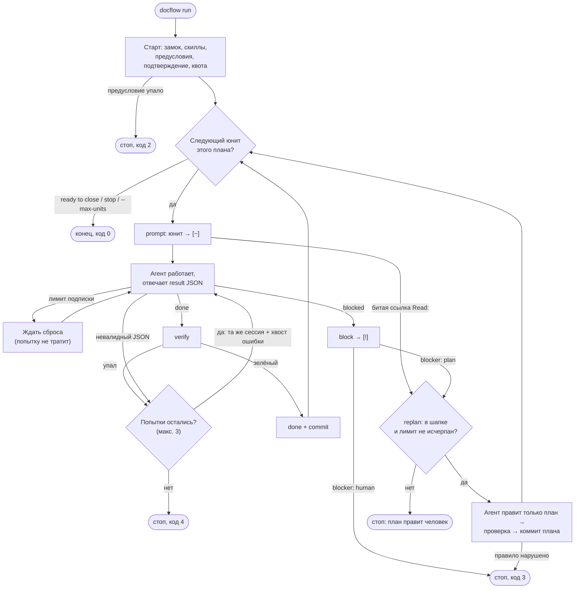

# Раннер

`docflow run` ведёт юниты текущего плана агентом без человека. Агент
только делает работу и возвращает result JSON; механику (`prompt`,
`verify`, `done`, `commit`, `block`) раннер запускает подпроцессом своего
же скрипта — те же проверки порядка и коды, что у человека. Почему —
[P006](../archive/P006-runner.md).



Схема без кодов 5 и 7 и остановки сигналом — они ниже.

Цикл на юнит:
1. `docflow prompt <id>` → `[~]`. Агенту уходит промпт юнита, где вместо
   `## Cycle` — `## Cycle (runner mode)`, плюс `instructions` профиля
   (только в режиме прав `auto`: они описывают песочницу, которой в
   `full` нет). Режим раннера требует `Verify` и тесты в foreground и не
   заканчивать ответ при живой фоновой задаче или субагенте: `claude -p`
   ждёт её 10 минут и отвечает без result JSON
   ([P019](../archive/P019-runner-background-tasks.md)).
2. Result JSON `blocked` → `docflow block --needs <класс> --reason`, код 3
   (`blocker: plan` — триггер авто-replan, см. ниже). `done` →
   `verify`; зелёный → `done` с handoff и decisions из JSON → `commit`.
3. `preflight`, `Verify`, `gate` или commit-hook упал, либо result JSON невалиден → та же сессия
   (`resume_args`) получает хвост вывода или причину; сессии нет — полный
   промпт и раздел `## Previous attempt`. Не больше `--attempts` (3)
   вызовов на юнит; исчерпано — юнит остаётся `[~]` либо ждёт завершения
   коммита, код 4 (проверка или хук) или 7. Ошибки Git вне хуков, включая
   подпись и права доступа, останавливают запуск без повторного вызова агента.
   Не `block`: `[!]` значит «план устарел».
4. `prompt` следующего юнита отверг ссылку `Read:` (файл переименован
   прошлым юнитом) → код 2 и строка «replan»: триггер авто-replan; без
   ключа `replan:` план правит человек.
5. Код 5 — агент закоммитил файл плана, переписал историю или сменил
   статус юнита. Прочие коммиты за время вызова (например, пины от
   инструмента выпуска) — строка-предупреждение, юнит продолжается
   ([P012](../archive/P012-runner-foreign-commits.md)). Вложенные репо из
   `repos:` проверяются так же: перезапись истории в них — код 5,
   коммиты агента — предупреждение с префиксом `<path>:`.
   Предохранитель до этого стопа: процесс агента получает
   `DOCFLOW_RUNNER_UNIT=<id>`, и `finish`, `done`, `commit`, `block` в нём
   отказывают с кодом 5 — запрет в промпте слабая модель нарушает.
   `docflow run` сбрасывает переменную: вложенный раннер (тесты) свой.

Авто-replan: план с ключом `replan: agent | model | effort` в шапке чинит
себя без человека. Триггеры — `blocked` с `blocker: plan` и отказ
`prompt` по ссылке `Read:`/Context (код 2); `blocker: human` и
исчерпанные попытки (код 4) — стоп без replan. Строка `<id> replan ->
agent | model | effort`, снимок дерева без файла плана и текста плана,
затем вызов агента маршрута `replan:` с промптом replan (правила:
править только план, снять блок — `[~]` над незакоммиченной работой,
`[ ]` над чистым деревом, не коммитить; список незакоммиченных файлов
в промпте; правила полны без скилла `bsv-docflow-plan`, которого у
агента может не быть) теми же механизмами, что юнит:
попытки, таймаут, ожидание лимита, отказ авторизации, режим прав плана,
`DOCFLOW_RUNNER_UNIT`, лог `<id>.replan<N>.out`. Ответ `blocked` — стоп,
код 3. Ответ `done` — HEAD не сдвинулся (коммит агента опустошает
`git diff HEAD` и потому невидим отпечатку дерева), дерево вне плана
не изменилось и `check_replan` пуст (шапка, Goal, Constraints,
Prerequisites и юниты `[x]`/`[-]` не тронуты, id юнитов на месте,
`lint` чист, юнит больше не `[!]`), план изменён, ссылки `Read:`/Context
юнита существуют и юнит не `[ ]` над незакоммиченной работой — иначе
следующий `prompt` отказал бы снова, а replan был бы потрачен на
пустой коммит: раннер коммитит план (`Pxxx: replan
Pxxx.N.M`, только файл плана), печатает
`<id> replanned: <sha> (+N units)`, и цикл берёт юнит заново — коммит
replan сдвигает HEAD, поэтому базу проверки чужих коммитов каждый юнит
берёт заново после него. Нарушение любого правила — план
восстанавливается текстом до вызова, проблемы печатаются, код 3.
Лимиты: 2 replan на юнит, `--replans N` (по умолчанию 3) на прогон;
превышение или план без `replan:` — прежний стоп со строкой `replan
limit reached`. Строка квоты печатается и после вызова replan, итоговая
строка прогона — `, N replans` ([P025](../archive/P025-autonomous-run.md)).

Незавершённый коммит имеет приоритет перед следующим юнитом: `run` повторяет
проверки и завершает его, без агента при успехе. При отказе проверки или хука
агент получает причину; уже созданные коммиты не переписываются.

Граница плана: раннер берёт следующий юнит, пока это тот же план; план
стал `ready to close` → код 0. Закрытие — человек с `bsv-docflow-close`:
архивная запись требует суждения. `--max-units N` — стоп раньше. Один
раннер на репозиторий: замок `<git-dir>/docflow/run/run.lock`, занят живым
процессом → код 2. Лог каждого вызова агента —
`<git-dir>/docflow/run/<id>.<n>.out`.

Старт прогона: сначала проверка скиллов docflow у каждого агента плана
(исполнители открытых юнитов и `replan:`) — как `doctor`: личный или
проектный каталог, копия равна `skills/` или ссылка на него. Нет или
устарел — жёлтая строка `skills: <агент>: not installed …; stale …;
update: …`, не стоп: цикл юнита и правила replan целиком в промпте
раннера; `DOCFLOW_SKILLS_CHECK=0` выключает ([P027](../archive/P027-skills-check-symlinks.md)). Затем план
объявляет режим прав `permissions: auto|full`
(нет ключа — `auto`) и предусловия `## Prerequisites`
([формат](format.md#план)). Раннер выполняет команды предусловий из корня
репозитория (таймаут 60 с, stdin закрыт: команда, ждущая ввода,
падает, а не висит) до квоты и агентов; провал или таймаут — код 2 со
строкой `prerequisite failed: <текст> (<команда>, exit N|timeout)` и
последней строкой вывода команды на каждый пункт. Затем,
если план просит `full` или есть предусловия без команды, печатает их и
спрашивает один раз `continue? [y/N]` — до `no_echo` и потока клавиш,
иначе их ввод съест ответ; `--yes` отвечает «да», stdin не TTY без `--yes`
— код 2, ответ «n» — код 1, ничего не запущено. Секция Prerequisites
целиком входит в промпт каждого юнита. Аргументы режима — таблица
`permissions` профиля, не код по имени агента; профиль без таблицы в
`auto` идёт с `cmd` как есть, `full` — ошибка до запуска (код 2)
([P025](../archive/P025-autonomous-run.md)).

Result JSON — единственный контракт с ассистентом:
`{"status": "done"|"blocked", "handoff": [...], "decisions": [...],
"unverified": [...], "reason": "...", "blocker": ""|"plan"|"human"}`.
У `done` handoff непустой и `blocker` пустой; у `blocked` есть reason, а
`blocker` называет того, кто снимает блок: `plan` — править план
(готовится авто-replan), `human` — нужен человек: вход, доступ, секрет,
устройство, решение. Ответ без поля (JSON-блок из текста) читается
по-старому: `blocked` считается `human`. `unverified` уходит в Handoff
с префиксом
`Unverified: `, печатается жёлтым после юнита, счётчик — в итоговой строке.
Берётся из поля вывода `result` профиля, иначе — последний блок
` ```json ` в тексте ответа (ассистенты без JSON-схем), иначе — голый
объект с ключом `status`, которым заканчивается ответ (малые модели,
например GLM-flash под pi, пропускают ограждение блока, и попытки
сгорали на «no result JSON»).

Конфиг — TOML, накладывается на встроенные профили по ключам; новый
ассистент — конфиг, не код. Ключи профиля, плейсхолдеры, порядок поиска
файла и коды выхода — [usage.md](../usage.md#автозапуск).

Маршрут юнита — ассистент, модель и усилие рассуждения. План с
исполнителями ([формат](format.md#план)) задаёт его сам: тройка юнита, иначе
шапки. Такой прогон берёт только встроенные адаптеры `claude`/`codex` — без
пользовательского файла, `$DOCFLOW_AGENTS` и XDG-конфига; `--config`,
`--agent`, `--model`, `--effort` отвергаются до запуска (код 2): исполнителя
меняют в плане. Ошибка назначения останавливает прогон до квоты и агента.
Режим решается по плану до чтения конфига; dry-run, стартовая квота,
продолжение сессии и повторы берут один и тот же маршрут. Встроенный
адаптер отвечает за способ вызова, план — за выбор
([P021](../archive/P021-plan-executors.md)). `run --dry-run --all` проверяет
маршруты оставшихся юнитов без агентов; `--plan` — только для dry-run, чтобы
проверить draft или отложенный план, а не обойти очередь в прогоне.

План без исполнителей (legacy) считает маршрут по
ярусу `fast|default|strong|max` из верхней таблицы `[tiers.<ярус>]`
(`agent`, `model`, `effort`). Ярус: `--model`, если это ярус, иначе
`Model:` юнита, иначе `default`; значение не из ярусов — id модели,
ассистент и усилие берутся из яруса `default`. `--agent` подменяет
ассистента и вместо `model` и `effort` яруса берёт `model` профиля (id из
`--model` остаётся); `--effort` перекрывает усилие. Маршрут считается на
каждый юнит: Claude Code и Codex CLI смешиваются в одном прогоне. Ярусы
держат план переносимым между ассистентами
([P015](../archive/P015-multi-agent-runner.md)). Явно названный файл конфига
(`--config`, `$DOCFLOW_AGENTS`), которого нет, — ошибка; нет файла по
умолчанию — встроенные профили.

Лимит подписки: ответ с ошибкой (флаг `error` или код ≠ 0) и время сброса
из данных ответа: Codex — rollout-файл вызова имеет `rate_limit_reached_type`
или окно с `used_percent` ≥ 100 → последний `resets_at`; Claude —
`rate_limit_event` со `status: rejected` → `resetsAt`. Данных нет — совпавший
`limit` (без учёта регистра) и время сброса из текста (10-значный epoch —
секунды, 13-значный — мс), иначе `limit_wait`. Ждать до сброса + 60 с;
затем продолжить сессию. Попытку не тратит; `--no-wait` или 10 лимитов
подряд → код 7. Regex к обычному ответу не применяется: агент может
цитировать файл про «rate limit».

Нет авторизации: строка ответа с ошибкой совпала с `auth` (без учёта
регистра; `claude` — «Failed to authenticate», «Not logged in», `codex` —
«401 Unauthorized», «codex login») → `<id>: <агент> is not logged in:
<строка>`, код 7 без повторов: попытки на это тратить незачем, юнит
остаётся `[~]`. Остальные отказы агента пишут в строку попытки первую
строку ответа, ошибки или stderr — причина видна без лога вызова.

Таймаут: SIGTERM группе процессов агента, через 10 с SIGKILL; считается
попыткой. Агент живёт в своей сессии и сигналы терминала не получает:
Ctrl-C, SIGTERM и SIGHUP (закрытый терминал) раннер ловит сам — та же
остановка группы агента, юнит остаётся `[~]`, код 128 + номер сигнала.
Мягкая остановка — файл `<git-dir>/docflow/run/stop` (`s` + Enter в
терминале раннера или `docflow run --stop`): раннер проверяет его между
юнитами и выходит с кодом 0; файл от прошлого запуска удаляется на старте.
Первое `s` раннер подтверждает строкой с id юнита, после которого план
остановится; дальнейший ввод читается и отбрасывается. Эхо терминала на
время прогона выключено (Enter иначе разрывает строку спиннера) и
восстанавливается при любом выходе.

Конец любого прогона, кроме остановки сигналом, уведомляет человека (нужен
и на `ready to close`, и на стопе): darwin — `osascript`, linux —
`notify-send` из `PATH`, без них — `\a` в терминал. Таймаут 5 с, ошибки
игнорируются. Текст: `<план>: ready to close`, `<id> blocked (needs
<класс>): <reason>` или причина остановки. `--no-notify` и
`DOCFLOW_NOTIFY=0` выключают.

В TTY старт, каждый юнит, replan и итоговая сводка выделены блоками с
отступами и переносом длинных сообщений по ширине терминала. Исполнитель
показан отдельной меткой (`Codex`, `Claude`, `pi` или имя профиля), рядом —
модель и цветной уровень reasoning: `low` — серый, `medium` — синий,
`high` — фиолетовый, `xhigh` и `max` — оранжевый, `ultra` — ярко-красный.
Надписи `Codex` и `Claude` белые; фон `Codex` — синий, `Claude` — оранжевый.
Статусы различаются и символами: `✓ Done`, `!` для замечаний, `↻ Replanned`.
Заголовок юнита — `<id>: <название>`. Пустая строка разделяет блоки;
внутри блока строки идут подряд. Переносы, включая `Unverified`, сохраняют
левую рамку и учитывают фактическую ширину терминала.
У `Blocked` и `replan Blocked` заголовок красный, причина — белая на
следующей строке с отступом, как у `Unverified`. Каждый начатый блок юнита
или replan завершается строкой `Time: <длительность>` перед квотой при любом
исходе, включая восстановление коммита, ошибку и прерывание. Это время всего
блока, включая попытки и проверки; в текстовом выводе — `<id> time: ...`.

Квоты в TTY подписаны `Quota · used`: полоса — израсходованная доля окна, рядом
точный процент и дельта в процентных пунктах. До 75% полоса зелёная,
с 75% — жёлтая, с 90% — красная. Окна стоят рядом, если ширины хватает,
иначе — на отдельных строках; `--verbose` добавляет строки времени сброса.
Квота закрывает блок юнита, итоговая сводка показывает дельты за весь запуск
(`Δ run`). `NO_COLOR` сохраняет рамки, подписи и символы статусов.

Текстовый вывод (pipe, `> log`, `TERM=dumb`): первая строка
`run: <план>, start HH:MM:SS` (при режиме `full` —
`, permissions full`); юнит — название,
модель, итог (попытки, время, сумма `cost` по вызовам); последняя строка —
`run: N units, HH:MM:SS–HH:MM:SS (<длительность>), $<сумма>` и квота по
агентам `claude 5h NN% (+D) · 7d NN% (+D)` (агенты через `; `), если
известна. После каждого юнита, при любом исходе (готов, блок, отказ, чужой
коммит, сигнал), без `-v` печатается `quota: <агент> 5h NN% (+D) · 7d NN%
(+D)` — изменение квоты за юнит. Сразу после первой строки — `quota:
<агент> 5h NN% · 7d NN%` по агентам оставшихся юнитов (через `; `): их
опрашивает команда профиля `quota` без вызова модели (`claude -p /usage`,
`codex app-server` → `account/rateLimits/read`), сбой зонда — агента нет
в строке. Дельты считаются от этого замера, без него — от первого
`rate_limit_event` агента в прогоне; окно сбросилось (время сброса сдвинулось
больше чем на 10 минут) — без дельты
([P018](../archive/P018-run-start-quota.md)). Итоговая сводка печатается при любой остановке (блок,
отказ, сигнал). `-v/--verbose` добавляет приглушённые строки: номер юнита,
`Verify`, попытку и лог, токены и ходы, к строке квоты — время сброса,
оценку остатка, таблицу юнитов. Спиннер (в verbose — с последним действием
агента) и цвета — только когда stdout это TTY и `TERM` не `dumb`;
`NO_COLOR` отключает цвета. Квоту Codex даёт не поток, а rollout-файл
`$CODEX_HOME/sessions/*/*/*/rollout-*-<thread_id>.jsonl` (последний
`token_count` с `rate_limits`; окна `primary` и `secondary` подписаны по
`window_minutes`: 300 → `5h`, 10080 → `7d`), читается после каждого вызова.
Квоту и действие Claude даёт декодер потока
`stream = "claude"` из `rate_limit_event` (`--output-format stream-json`);
профиль без `stream` их не показывает
([P011](../archive/P011-runner-output.md)).

Профиль `claude`: `claude -p --output-format stream-json --verbose
--json-schema {schema}`; аргументы режима прав добавляет таблица
`permissions` профиля: `auto` — `--permission-mode auto
--permission-prompts none`, команды агента
проверяет классификатор `auto`; `full` — `--permission-mode
bypassPermissions`. Haiku `auto` не поддерживает и без явных
прав получает отказ на любую запись: `model_extra` даёт ему
`--allowedTools Write Edit Bash` ([P007](../archive/P007-auto-permission-mode.md))
по точному имени — ярусу `haiku` и полному `claude-haiku-5-5` из `Executor`.
`--bare` не годится: не берёт логин подписки. Нужен собственный вход CLI
(`claude auth login`).

Профиль `pi`: `pi -p --mode json`, промпт в stdin; модель `--model
<provider/id>` из тройки как есть (каталога моделей в коде нет), усилие —
`--thinking`, продолжение — `--session <id>` из события `session`. Права:
у pi нет песочницы и подтверждений инструментов, `auto` не добавляет
аргументов, `full` добавляет `--approve` — доверие проектным файлам
(`.pi/skills/`, расширения). Декодер
`stream = "pi"` сворачивает JSON Lines в объект `session`, `text` (последний
`message_end` с `role: assistant`), `usage` и `cost` (суммы по всем
assistant `message_end`: каждый — отдельный вызов API), `is_error` (true, пока
не было assistant `message_end`, при `stopReason: "error"` в нём и при
`agent_settled.aborted`), `error` (`errorMessage`: ошибка API выходит с
кодом 0, текст лимита виден regex `limit` только через это поле). Токены —
`input + cacheRead + cacheWrite`, не `totalTokens` (в нём reasoning). Ключа
`quota` нет: pi не отдаёт остаток подписки отдельной командой. Строки
`limit` общие с codex, для z.ai не проверены; `auth` — только
`no api key found` ([P026](../archive/P026-pi-agent.md)).

Профиль `codex`: `codex exec --json --output-schema {schema_file}`,
аргументы режима прав из таблицы `permissions`: `auto` —
`--approve-for-me -c sandbox_workspace_write.network_access=true`,
`full` — `--dangerously-bypass-approvals-and-sandbox`.
Продолжение — `resume <thread_id>` в конце argv, промпт в stdin и там.
Декодер `stream = "codex"` сворачивает JSON Lines в один объект: `thread_id`,
`text` (последний `agent_message`, в нём result JSON), `usage` (последний
`turn.completed`), `is_error`/`error` (`turn.failed` или `error`). Токены —
только `input_tokens`: `cached_input_tokens` уже входят в них. Ответ с флагом
`error` — неудачная попытка, как код ≠ 0. Песочница workspace-write с сетью и
`--approve-for-me` ближе всего к `auto` у Claude: запись вне репозитория
(`~/.gradle`, DerivedData) агент просит с эскалацией, и её проверяет
автоматический ревьюер; об этом говорит `instructions` профиля
([P015](../archive/P015-multi-agent-runner.md)) — она уходит агенту
только в режиме `auto`: в `full` песочницы нет. `--output-schema` строгий:
все ключи `RESULT_SCHEMA` обязательны, неиспользуемые — пустой список или
строка; одна схема на всех ассистентов, Claude её тоже принимает.
